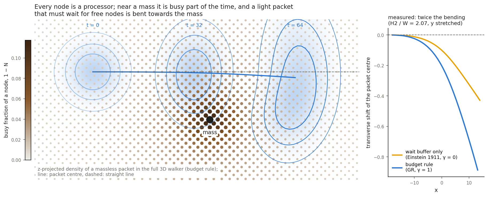

# Triangular Lattice Geometry

[](https://doi.org/10.5281/zenodo.22178584)

*Thomas Schmiereck — thomas@schmiereck.de*

---

## Paper 1: Relativistic Quantum Mechanics from Lattice Geometry

**Emergent Speed of Light, Mass, and Time Dilation on an Equilateral Triangular Lattice**

### Abstract

A discrete path-integral model on a **1+1D equilateral triangular lattice** and its **2+1D hexagonal extension** in which all relativistic structure emerges purely from lattice geometry.

**README**: [`README1_lattice_geometry.md`](docs/README1_lattice_geometry.md)  
LaTeX version: [`paper.tex`](papers/paper.tex)  
PDF version: [`paper.pdf`](papers/paper.pdf)  
German version: [`paper_de.tex`](papers/paper_de.tex) / [`paper_de.pdf`](papers/paper_de.pdf)  
DOI: [10.5281/zenodo.22178585](https://doi.org/10.5281/zenodo.22178585) (release v1.0.0, see [Citation](#citation))

---

## Paper 2: Internal Structure of the Equilateral Lattice Path Integral

**Crystal Angular Momentum, Emergent Vector Ground State, and Symmetry Breaking by Confinement**

### Abstract

In a previous paper we showed that an equilateral triangular (1+1D) and
hexagonal (2+1D) path-integral lattice with the single amplitude rule
"direction change = iε" reproduces relativistic dispersion, exact isotropy
and the speed of light c = √3 from geometry alone. Here we analyse the
**internal structure** of the physical propagating band of the same model,
in 2+1D and in a natural 3+1D tetrahedral-octahedral (cuboctahedron)
extension.

follow-up to [`paper.tex`](papers/paper.tex) / [`paper.pdf`](papers/paper.pdf) / [`README1_lattice_geometry.md`](docs/README1_lattice_geometry.md)

**README**: [`README2_internal_structure.md`](docs/README2_internal_structure.md)  
LaTeX version: [`paper2_internal_structure.tex`](papers/paper2_internal_structure.tex)  
PDF version: [`paper2_internal_structure.pdf`](papers/paper2_internal_structure.pdf)  
DOI: [10.5281/zenodo.23888331](https://doi.org/10.5281/zenodo.23888331) (release v2.0.0, see [Citation](#citation))

---

## Paper 3: Gravity as Computation Time

**A Local Budget Rule on a Spin-½ Phase-Bit Lattice and its Post-Newtonian Limit**



### Abstract

Can gravity be modelled as a local limit on how fast each node of a discrete
quantum lattice can compute? The test particle is a unitary quantum walker on
the FCC lattice whose spin ½ is carried by a **finite register** (the binary
octahedral group 2O); reversing the heading without rotating the spin is the
lattice Dirac mass. Slowing only the internal clock gives Nordström gravity, a
local wait buffer gives Einstein's 1911 theory, and a single node rule —
**every process needs each node it involves to be free** (one node for the
clock, two for a hop) — gives the spatial metric A = 1/N and **γ = β = 1**.
In the full 3+1D walker light is deflected **2.07×** more strongly than with
waiting alone (GR: 2), the lattice metric gives the GR perihelion advance and
Lense–Thirring precession, and a lattice gravitational atom reproduces the
gravitational fine structure (∝ 2γ + 1) and hyperfine shifts of the Dirac
equation in the metric to 1–4 %. What is imposed (field equations, vacuum
counterterm, gyroscope rule) is stated explicitly; the tensor sector
(gravitational waves) is the open question.

follow-up to [`paper2_internal_structure.pdf`](papers/paper2_internal_structure.pdf) / [`README2_internal_structure.md`](docs/README2_internal_structure.md)

**README**: [`README3_gravity_computation_time.md`](docs/README3_gravity_computation_time.md)  
LaTeX version: [`paper3_gravity_computation_time.tex`](papers/paper3_gravity_computation_time.tex)  
PDF version: [`paper3_gravity_computation_time.pdf`](papers/paper3_gravity_computation_time.pdf)  
DOI: [10.5281/zenodo.23982020](https://doi.org/10.5281/zenodo.23982020) (release v3.0.0, see [Citation](#citation))  
Research notes behind every number (German): see [Paper 3 notes](#paper-3-research-notes-in-german) below

---

## Further Investigations (work in progress, notes in German)

Building on the 2+1D hexagonal model, a **turning-phase model** replaces the
amplitude rule by the *sum of turning angles*, scaled by a parameter α:
`w_path = ∏ a(|n|) · exp(i·α·60°·n)`. For every closed walk the angle sum is
exactly 360°·w (discrete Whitney theorem), so α acts as an Aharonov–Bohm flux
in heading space; α = ½ gives the spinor double cover. The coin operator is
exactly unitary.

| Topic | Result | Notes |
|-------|--------|-------|
| Turning-phase model (2+1D) | Exact unitarity, Kramers doubling at α = ½, massless cone with slope c/2 | [`RESULTS_Turning_2D_de.md`](docs/RESULTS_Turning_2D_de.md) |
| Magnetic field (Peierls phase) | Cyclotron orbits, chirality families, Onsager quantisation | [`RESULTS_Magnetic_2D_de.md`](docs/RESULTS_Magnetic_2D_de.md) |
| 3D spin and QCD roadmap | Why spin needs 3D (no winding number on S²), what QCD needs | [`ROADMAP_QCD_3D_de.md`](docs/ROADMAP_QCD_3D_de.md) |
| SU(3) Wilson-action Monte Carlo | Area law vs perimeter law on the triangular lattice | [`RESULTS_SU3_MC_de.md`](docs/RESULTS_SU3_MC_de.md) |
| 3+1D FCC walker with SU(2) coin | α disappears: spin 0 or spin ½ only, Kramers automatic | [`RESULTS_FCC_3D_de.md`](docs/RESULTS_FCC_3D_de.md) |
| Two-particle Hilbert space | Pauli hole, bound states, colour singlet | [`RESULTS_TwoParticle_de.md`](docs/RESULTS_TwoParticle_de.md) |
| 2+1D deflection scattering | Mott interference, capped by the helicity-like band eigenvector | [`RESULTS_Scatter_2D_de.md`](docs/RESULTS_Scatter_2D_de.md) |
| Helicity test | Internal spin does not lift the cap; the non-relativistic limit does | [`RESULTS_Helicity_de.md`](docs/RESULTS_Helicity_de.md) |
| Caching on the regular lattice | Memoised walk enumeration | [`NOTES_Caching_de.md`](docs/NOTES_Caching_de.md) |

### Paper 3: research notes (in German)

Discrete states, phase bits and **gravity as computation time**: [`ROADMAP_Paper3_de.md`](docs/ROADMAP_Paper3_de.md)
(source idea: [`SOURCE_Paper3_Gemini_Thread_de.md`](docs/SOURCE_Paper3_Gemini_Thread_de.md)).

| Topic | Result | Notes |
|-------|--------|-------|
| Exp. S1: spin vortices from phase bits | Integer path counts N[x,d,p,T] with a Z₄ phase bit; 12 of 24 labels reachable (Z₁₂ double cover); bit = −1 exactly for odd winding; half-quantum vortices in heading space form Kramers doublets | [`RESULTS_PhaseBit_S1_de.md`](docs/RESULTS_PhaseBit_S1_de.md) |
| Exp. S2: vortex dynamics | Spin sector exactly protected (superselection, 8e-16); massless without reversal (ring at c/2); chiral 180° reversal gives mass 8μ at the cost of Kramers; v < c; Zitterbewegung j=7↔5 at the band splitting | [`RESULTS_PhaseBit_S2_de.md`](docs/RESULTS_PhaseBit_S2_de.md) |
| Exp. S3: finite spin register in 3D | Binary octahedral group 2O (quarter turn per 60° heading turn): 4 register states per heading, quantised holonomy (triangle π, square 2π), Kramers at every k, exact particle–antiparticle symmetry E ↔ −E (absent with continuous SU(2)) | [`RESULTS_PhaseBit_S3_de.md`](docs/RESULTS_PhaseBit_S3_de.md) |
| Exp. S4: mass for the 3D spin vortex | Symmetry analysis at the Dirac point: μ·Π (reverse the heading without rotating the spin = inversion = lattice β) opens a gap of exactly 4μ, keeps Kramers at every k, and with 2O keeps E ↔ −E — a massive, time-reversal-symmetric spin-½ particle from a finite register | [`RESULTS_PhaseBit_S4_de.md`](docs/RESULTS_PhaseBit_S4_de.md) |
| S4 open points | Θ of S4 is PT (true T = ΠΘ); helicity is an exact lattice chiral symmetry, so the parity-odd mass is just a chirally rotated μ·Π; in 2D the Dirac point is a single Kramers pair, so no T-preserving mass exists; the k² background is cancelled exactly at the interior Dirac point; Dirac-regime dynamics via an exact k-space method | [`RESULTS_PhaseBit_S4_Open_de.md`](docs/RESULTS_PhaseBit_S4_Open_de.md) |
| S4 open points, round 2 | One extra 2O term (90° spin transport, coupling ≈ −5ε) removes the k² background of the 2O Dirac quartet while keeping E ↔ −E, without doubling — the cleanest massive spin-½ particle so far (2 % Dirac up to k = 0.4 at μ/ε = 0.5); θ becomes observable next to a helicity-breaking mass; a mass-sign domain wall carries a T-protected massless 2D Dirac cone (the 2D spin vortex is the boundary state of the 3D one); Zitterbewegung amplitude matches band theory to 0.6 % | [`RESULTS_PhaseBit_S4_Open2_de.md`](docs/RESULTS_PhaseBit_S4_Open2_de.md) |
| S4 open points, round 3 (incl. Exp. 1b) | With the Dirac point at quasi-energy 0, the clean 2O* particle satisfies the equivalence principle (R′ = 0.997 for particle and antiparticle; the uncompensated band gives 0.73/1.20); a clock lapse is Nordström gravity (light not deflected), a full lapse is Einstein 1911 (light falls like slow matter); a single Kramers pair on a mass domain wall survives T-even disorder, two pairs gap out (Z2); helicity commutes with any gauge field, so θ stays unobservable | [`RESULTS_PhaseBit_S4_Open3_de.md`](docs/RESULTS_PhaseBit_S4_Open3_de.md) |
| S4 open points, round 4 (incl. Exp. 1c) | A wait buffer per node (phase π, local mixing) is an exactly unitary, strictly local full lapse: it rescales the spectrum around E = 0 by N, the buffer holding the fraction 1 − N ("limited compute time per node"); buffer lapse N/A plus mass μA gives the weak-field GR metric — light is deflected twice as strongly (1.999), moving matter by 1 + v²/c′²; the vacuum counterterm is forced (particle and antiparticle fall with R′ = 1 ± δ/m); E ∥ B pumping in time shows the opposite chiral branch at the interior Weyl node | [`RESULTS_PhaseBit_S4_Open4_de.md`](docs/RESULTS_PhaseBit_S4_Open4_de.md) |
| S4 open points, round 5 (incl. Exp. 1d) | One wait buffer covers every lapse 0 < N ≤ 1, and for any local wait rule the lapse is the active weight of the vacuum fixed vector; a photon running into N → 0 is blueshifted up to the lattice cutoff and then turns back (a mirror, not a horizon); a lapse sourced by the local load (energy density, zero for the vacuum) makes active = passive mass = energy and obeys the third law to 2 %, but a moving source pulls with E, not E(1 + v²); heading-dependent waits average out, heading-dependent coin couplings give any traceless metric (gravitational-wave interferometer matches GR as k → 0); det U(k_z) of the magnetic chain does not wind | [`RESULTS_PhaseBit_S4_Open5_de.md`](docs/RESULTS_PhaseBit_S4_Open5_de.md) |
| S4 open points, round 6 | The source s = 2e − e_M (twice the computational load minus the mass load μ∂E/∂μ, both measured locally) is T₀₀ + T_ii: a moving source pulls with E(1 + v²) and light twice as strongly; with a local wave equation for Φ the test particle feels the source only after D/c′; a falling massive particle is reflected at the lattice cutoff and bounces back almost to its starting height; the helicity sector has no global quasi-energy gap, so only the net spectral flow (zero) is topological | [`RESULTS_PhaseBit_S4_Open6_de.md`](docs/RESULTS_PhaseBit_S4_Open6_de.md) |
| Hypothesis H1 and proper time | Read as single particles, antiparticles would carry negative load and a particle–antiparticle pair would run away together without momentum conservation, so the model excludes this; measured relative to the filled Dirac sea (hole picture) antimatter attracts exactly like matter. The local mass load is m·dτ/dt with dτ/dt = N√(1 − v²): motion eats computing time (E = m·dτ/dt + p·v), and its space-time integral is m·τ = −S | [`RESULTS_H1_Antimatter_ProperTime_de.md`](docs/RESULTS_H1_Antimatter_ProperTime_de.md) |
| Hypothesis H2: one budget rule | Any combination of wait buffers is a pure lapse (hop and clock slowed alike, γ = 0); the rule "every process needs each node it involves to be free" — clock one node, hop two — realised by a wait gate and a stay gate (hop refused, clock keeps running) gives H = N²K + NM, i.e. A = 1/N and γ_PPN = 1 (band level to 3e-4 down to N = 0.3; light deflected twice as strongly as with waiting alone, γ = 0.99–1.03); price: an O(Δt) background −0.245·N(1 − N)·k² | [`RESULTS_H2_BudgetRule_de.md`](docs/RESULTS_H2_BudgetRule_de.md) |
| H2 continued: compensation and β_PPN | A loaded node that retunes its 90°-transport coupling (Δλ ≈ 3.3(1 − N)) removes the stay-gate background: light is deflected with γ = 1.00 ± 0.007 at every k, Dirac-regime packets with γ = 0.99–1.00 (works down to N ≈ 0.4); β_PPN is fixed by how two loads combine at a node — linear lapse 1/2, queued waits 3/2, nested gates (free for both, N = N₁N₂) exactly 1, also in strong fields; with the source T₀₀ + T_ii and load ∝ N this reproduces the 1PN g₀₀ of GR; g₀ᵢ is still missing | [`RESULTS_H2b_Compensation_Beta_de.md`](docs/RESULTS_H2b_Compensation_Beta_de.md) |
| g₀ᵢ: gravitomagnetism | A heading-independent drag hop (every state handed on along the momentum current of the load, strength from the momentum density, GR factor 4) is exactly b·p for all states and leaves vacuum and Kramers pairs untouched (a heading-dependent gate would split Kramers pairs and shift the vacuum); two moving sheets: parallel light beams no longer attract (0.019, packet GR 0.022), antiparallel ones twice as strongly (1.99), the gravitomagnetic force matches GR to ≤ 1.2 %; co-moving sheets fall like 1/γ³ (relativity principle) instead of γ(1+v²)² | [`RESULTS_G0i_Gravitomagnetism_de.md`](docs/RESULTS_G0i_Gravitomagnetism_de.md) |
| Causal g₀ᵢ | Lapse Φ and shift b as local wave equations with the local light speed c′N₀²: the test force follows static force × light-cone fraction to a few per cent; parallel light beams feel nothing at any time (+0.01 before arrival) only if Φ and b travel together, whereas an instantaneous shift beside a retarded lapse repels them before the lapse arrives (+1030) — a superluminal signal | [`RESULTS_G0i_Causal_de.md`](docs/RESULTS_G0i_Causal_de.md) |
| Exp. 3: isotropy of shells and front | The cuboctahedral shells (the original "discrete Bloch sphere") never become isotropic: C₄ = 3.22·10⁻³ from n ≈ 8 on, the polyhedron limit (only a 3-design); isotropy is dynamical instead: the particle (Dirac quartet) moves isotropically with C₄ ∝ (a/σ)⁴, while the other 20 modes stay cubically warped; a 3D point source (n = 64) converges to the long-time limit, its front sits at r/t ≈ 0.86–0.92 (≈ 0.5 c) and the geometric shell itself carries practically no probability | [`RESULTS_Exp3_Isotropy_de.md`](docs/RESULTS_Exp3_Isotropy_de.md) |
| Gravity in 3D | The local field equation gives the 1/r potential, and its causal version settles at the static value behind the front instead of growing as in 1D; light passing a point mass in the full 3D walker is deflected 2.07/2.06 times as strongly with the H2 rule (spatial metric) as with waiting alone — the full GR deflection 4GM/b instead of Einstein-1911's 2GM/b — and the local force law matches the simulation to ≤ 2.7 %; an observer inside the lattice defines spheres with his own signals, so only agreement between probes is testable, which holds to (a/λ)² | [`RESULTS_Gravity3D_de.md`](docs/RESULTS_Gravity3D_de.md) |
| Observer, perihelion, Lense–Thirring | An observer inside the lattice comparing two light energies in a turned apparatus finds a direction dependence ∝ (ka)² (9·10⁻⁵ at k = 0.05) and an energy dependence 1 − 0.42 (ka)²; the 3D walker follows the local force of the metric to ≤ 1 % (r ≥ 13, kinetic energy gravitates too); classical orbits of the lattice metric give (2 + 2γ − β)/3 of the GR perihelion advance, the H2 rule exactly the GR value; a rotating ball produces the GR gravitomagnetic dipole and the Lense–Thirring node precession (1.001); in the walker a local drag hop carries packets along, but a gyroscope turns only with an extra rule (internal rotation by ½∇×b with the lattice's own generator J = (2i/π) log R₉₀, g = 1 for particle and antiparticle; the bare spin index has g = −1/3 for the particle) | [`RESULTS_Observer_Perihelion_LT_de.md`](docs/RESULTS_Observer_Perihelion_LT_de.md) |
| Gravitational atom | The quantum version of the perihelion advance: the metric lifts the l-degeneracy of the 1/r potential, higher l is less bound, and the l-splittings of the rules relate like the classical perihelion advances (wait only / H2 = 0.22 → 0.31 towards 1/3, linear lapse / H2 ≈ 7/6), scaling as GM⁴; the effective Hamiltonian is checked against the bound states of the 1D lattice atom (0.2–3 %, including the H2 − W shift); spin (fine structure) not yet included | [`RESULTS_GravAtom_de.md`](docs/RESULTS_GravAtom_de.md) |
| Gravitational spin-orbit coupling | Fine structure of the gravitational atom: the Dirac equation in the metric predicts E(2p3/2) − E(2p1/2) ∝ 2γ + 1 (de Sitter precession), i.e. wait only : H2 : linear lapse = 1 : 3 : 3 in the weak field (1 : 3.64 : 4.50 at α_f = 0.3); a 2D gravitational atom in a slab of the full 3D walker (340 × 340 × 2, 8000 ticks, filter diagonalisation of the time signal) reproduces it to 0.8–1.5 % once the lattice band's spin-independent Wilson-like term is included; 2p3/2 lies above 2p1/2 | [`RESULTS_GravSpinOrbit_de.md`](docs/RESULTS_GravSpinOrbit_de.md) |
| Gravitational hyperfine structure | Lense-Thirring coupling of the 2p atom to the angular momentum J of the central body: orbit (drag hop b·p) : spin (rule ½ curl b·J_int, gyrogravitomagnetic ratio 1) = 2 : −1 as in GR, so 2p3/2 : 2p1/2 = 3 : 5 far out (0.560 with core and strong field); the 2D atom in the 3D walker with drag hop and spin rule (six runs, ±J) reproduces the shifts to 2.7–3.5 %, the spin part to 2–4 % with the right sign, and the ratio to 0.6 % (0.5638 vs 0.5604; 0.756 without spin) | [`RESULTS_GravHyperfine_de.md`](docs/RESULTS_GravHyperfine_de.md) |
| Exp. 1a: lapse on the internal clock (ε → ε·N) | Universal free fall (O(ε²) lattice violation) but R = m₀/(m\*c²) = 2; moving particles decouple ∝ 1/γ² → Nordström-type scalar gravity, no light bending | [`RESULTS_Gravity_Lapse_de.md`](docs/RESULTS_Gravity_Lapse_de.md) |

---

## Repository Layout

| Directory | Content |
|-----------|---------|
| [`papers/`](papers) | LaTeX sources and PDFs of the papers, `PAPER_SUMMARY.md` |
| [`docs/`](docs) | Paper READMEs, result write-ups (`RESULTS_*.md`), notes, interactive HTML |
| [`src/`](src) | Python simulations and figure scripts |
| [`figures/`](figures) | Generated figures and animations |
| [`data/`](data) | Numerical results (`.npz`) |

Scripts can be run from any directory, e.g. `python src/quantum_hex_2d.py`;
output paths are resolved by [`src/paths.py`](src/paths.py).
The papers are built from inside `papers/` (`pdflatex paper.tex`) and take
their figures from `../figures/`.
Dependencies: [`requirements.txt`](requirements.txt).

---

## Citation

The papers are archived on Zenodo as releases of this repository.

**Paper 1** (release v1.0.0):

> Schmiereck, T. (2026). *Relativistic Quantum Mechanics from Lattice Geometry:
> Emergent Speed of Light, Mass, and Time Dilation on an Equilateral Triangular
> Lattice* (v1.0.0). Zenodo. https://doi.org/10.5281/zenodo.22178585

```bibtex
@software{schmiereck_2026_paper1,
  author    = {Schmiereck, Thomas},
  title     = {Relativistic Quantum Mechanics from Lattice Geometry:
               Emergent Speed of Light, Mass, and Time Dilation
               on an Equilateral Triangular Lattice},
  year      = {2026},
  month     = aug,
  version   = {v1.0.0},
  publisher = {Zenodo},
  doi       = {10.5281/zenodo.22178585},
  url       = {https://doi.org/10.5281/zenodo.22178585}
}
```

**Paper 2** (release v2.0.0):

> Schmiereck, T. (2026). *Internal Structure of the Equilateral Lattice Path
> Integral: Crystal Angular Momentum, Emergent Vector Ground State, and Symmetry
> Breaking by Confinement* (v2.0.0). Zenodo. https://doi.org/10.5281/zenodo.23888331

```bibtex
@software{schmiereck_2026_paper2,
  author    = {Schmiereck, Thomas},
  title     = {Internal Structure of the Equilateral Lattice Path Integral:
               Crystal Angular Momentum, Emergent Vector Ground State,
               and Symmetry Breaking by Confinement},
  year      = {2026},
  month     = nov,
  version   = {v2.0.0},
  publisher = {Zenodo},
  doi       = {10.5281/zenodo.23888331},
  url       = {https://doi.org/10.5281/zenodo.23888331}
}
```

**Paper 3** (release v3.0.0):

> Schmiereck, T. (2026). *Gravity as Computation Time: A Local Budget Rule on a
> Spin-1/2 Phase-Bit Lattice and its Post-Newtonian Limit* (v3.0.0). Zenodo.
> https://doi.org/10.5281/zenodo.23982020

```bibtex
@software{schmiereck_2026_paper3,
  author    = {Schmiereck, Thomas},
  title     = {Gravity as Computation Time: A Local Budget Rule
               on a Spin-1/2 Phase-Bit Lattice
               and its Post-Newtonian Limit},
  year      = {2026},
  month     = nov,
  version   = {v3.0.0},
  publisher = {Zenodo},
  doi       = {10.5281/zenodo.23982020},
  url       = {https://doi.org/10.5281/zenodo.23982020}
}
```

To cite the repository as a whole (always resolving to the latest release), use
the concept DOI [10.5281/zenodo.22178584](https://doi.org/10.5281/zenodo.22178584).
Citation metadata is also provided in [`CITATION.cff`](CITATION.cff)
(GitHub: *Cite this repository*).
