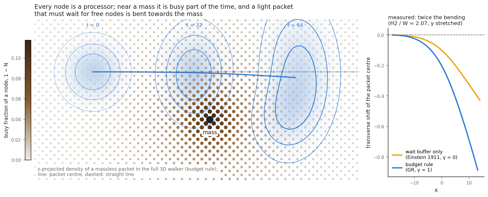
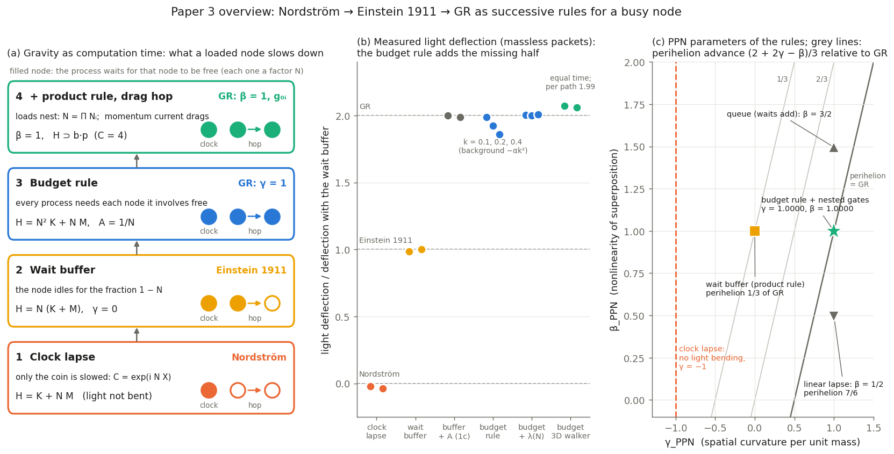

# Gravity as Computation Time

**A Local Budget Rule on a Spin-½ Phase-Bit Lattice and its Post-Newtonian Limit**

*Thomas Schmiereck — thomas@schmiereck.de*

follow-up to [`paper2_internal_structure.pdf`](../papers/paper2_internal_structure.pdf) / [`README2_internal_structure.md`](README2_internal_structure.md)
and [`paper.pdf`](../papers/paper.pdf) / [`README1_lattice_geometry.md`](README1_lattice_geometry.md)

LaTeX version: [`paper3_gravity_computation_time.tex`](../papers/paper3_gravity_computation_time.tex)  
PDF version: [`paper3_gravity_computation_time.pdf`](../papers/paper3_gravity_computation_time.pdf)

*Light passing a point mass in the full 3+1D walker. Each node is shaded by the fraction of time it is busy
(1 − N); the side of the packet closer to the mass lags behind and the packet bends towards the mass —
twice as strongly with the budget rule as with waiting alone (2.07, GR: 2).*

---

## Abstract

We ask whether gravity can be modelled as a local limit on how fast each node of a discrete quantum lattice
can compute. The test particle is a unitary quantum walker on the face-centred-cubic lattice whose spin is
carried by a finite register, the binary octahedral group 2O: every 60° turn rotates the spinor by a quarter
turn about a cube axis. This gives spin ½ with Kramers degeneracy at every momentum, the belt-trick sign, and
exact particle–antiparticle symmetry; a single extra amplitude, "reverse the heading without rotating the
spin", is the lattice Dirac mass mβ (gap exactly 4μ).

Slowing down only the internal clock gives Nordström gravity; a local wait buffer per node gives Einstein's
1911 theory (half light bending). A single node rule — **every process needs each node it involves to be
free**, one node for the clock and two for a hop — produces H = N²K + NM, i.e. a spatial metric A = 1/N and
γ_PPN = 1. Combining loads at a node as independent occupations (N = ∏ Nᵢ) gives β_PPN = 1, and a
direction-independent drag hop supplies g₀ᵢ with the coefficient the relativity principle demands. In the
full 3+1D walker light is deflected 2.07 times more strongly than with waiting alone, the classical orbits
of the lattice metric give the GR perihelion advance, and a lattice "gravitational atom" reproduces the fine
structure ∝ 2γ + 1 (de Sitter) and the Lense–Thirring hyperfine shifts of the Dirac equation in the
corresponding metric to 1–4 %.

---

## The ladder: Nordström → Einstein 1911 → GR

| Rung | What a loaded node slows down | Hamiltonian | Theory | Measured |
|------|-------------------------------|-------------|--------|----------|
| Clock lapse | only the internal clock (coin) | H = K + NM | Nordström | light not deflected |
| Wait buffer | the whole node idles for the fraction 1 − N | H = N(K + M) | Einstein 1911, γ = 0 | light falls like slow matter |
| Budget rule | clock needs 1 free node, a hop needs 2 | H = N²K + NM, A = 1/N | GR, γ = 1 | γ = 1.0000 (band), light 2.005 / 1.998 / 2.007 × wait buffer |
| Product rule | loads nest: N = N₁N₂ | — | GR, β = 1 | β = 1.0000 up to N₁₂ = 0.49 (linear lapse 1/2, queued waits 3/2) |
| Drag hop | every state is handed on along the momentum current of the load | H ⊃ b·p, C = 4 | GR, g₀ᵢ | gravitomagnetic force to ≤ 1.2 %, co-moving sheets 1/γ³ |

The source is the measured computational load: s = 2e − e_M = T₀₀ + Tᵢᵢ (a moving source pulls with
E(1 + v²), light twice as strongly), and the local mass load is m·dτ/dt (proper time is consumed computing
time).

## Tests in the full 3+1D walker

| Test | Lattice | Reference |
|------|---------|-----------|
| Light deflection by a point mass, budget rule / wait buffer | 2.071 / 2.058 (b = 12 / 20) | GR: 1 + γ = 2 |
| Perihelion advance of classical orbits in the lattice metric | (2 + 2γ − β)/3 of GR; budget rule 1.003 (a = 1600) | GR: 1 |
| Lense–Thirring node precession (rotating ball) | 1.001 | GR: 1 |
| Gravitational atom, l-splitting (wait buffer / budget rule) | 0.22 → 0.31 | perihelion ratio 1/3 |
| Fine structure 2p3/2 − 2p1/2 (2D atom in a slab of the 3D walker) | wait buffer / budget rule / linear lapse: 0.985 / 1.008 / 1.012 of Dirac in the metric (with the lattice band's Wilson-like term) | ∝ 2γ + 1 (de Sitter) |
| Hyperfine (Lense–Thirring) shifts, orbit + spin | 2.7–3.5 %; ratio 2p3/2 : 2p1/2 = 0.5638 | Dirac + b terms: 0.5604 |

## What is derived and what is imposed

**Derived from local rules:** spin ½, Kramers and the belt-trick sign from a finite register; the Dirac mass
as reversal without spin rotation; the lapse as the waiting fraction of a node; γ = 1 from counting the nodes
a process involves; β = 1 from combining loads as independent occupations; the source T₀₀ + Tᵢᵢ and proper
time from the computational load; the drag coefficient C = 4 from the relativity principle.

**Imposed:** the field equations for the lapse Φ and the shift b; the vacuum counterterm and the λ(N)
retuning of the loaded node; the gyroscope rule ½ ∇×b·J_int (the bare spin index gives g = −1/3); equal
weighting of departure and arrival nodes (N_w = N_h).

**Lattice signatures:** a mirror instead of a horizon (a photon running into N → 0 is blueshifted to the band
edge and turns back); an energy-dependent light speed 1 − 0.42(ka)² with a cubic anisotropy ∝ (ka)²; the
vacuum energy gravitates unless subtracted (the cosmological-constant problem as an explicit lattice
counterterm).

**Open:** the tensor sector. The model has two scalars (N, A = 1/N) and a vector (b); whether an oscillating
load radiates two transverse-traceless polarisations — or whether the budget rule is a scalar–vector theory
that only mimics GR in the solar system — is the next test.

---

## Files referenced

### Result documents (German, exact numerics)

| Topic | Document |
|-------|----------|
| Particle: phase bits, 2O register, mass μΠ | [`RESULTS_PhaseBit_S1_de.md`](RESULTS_PhaseBit_S1_de.md) … [`RESULTS_PhaseBit_S4_Open2_de.md`](RESULTS_PhaseBit_S4_Open2_de.md) |
| Clock lapse, full lapse, wait buffer, load as source | [`RESULTS_Gravity_Lapse_de.md`](RESULTS_Gravity_Lapse_de.md), [`RESULTS_PhaseBit_S4_Open3_de.md`](RESULTS_PhaseBit_S4_Open3_de.md) … [`RESULTS_PhaseBit_S4_Open6_de.md`](RESULTS_PhaseBit_S4_Open6_de.md) |
| Antimatter, proper time | [`RESULTS_H1_Antimatter_ProperTime_de.md`](RESULTS_H1_Antimatter_ProperTime_de.md) |
| Budget rule, compensation, β | [`RESULTS_H2_BudgetRule_de.md`](RESULTS_H2_BudgetRule_de.md), [`RESULTS_H2b_Compensation_Beta_de.md`](RESULTS_H2b_Compensation_Beta_de.md) |
| Gravitomagnetism | [`RESULTS_G0i_Gravitomagnetism_de.md`](RESULTS_G0i_Gravitomagnetism_de.md), [`RESULTS_G0i_Causal_de.md`](RESULTS_G0i_Causal_de.md) |
| 3D: isotropy, light deflection, perihelion, Lense–Thirring | [`RESULTS_Exp3_Isotropy_de.md`](RESULTS_Exp3_Isotropy_de.md), [`RESULTS_Gravity3D_de.md`](RESULTS_Gravity3D_de.md), [`RESULTS_Observer_Perihelion_LT_de.md`](RESULTS_Observer_Perihelion_LT_de.md) |
| Gravitational atom, fine and hyperfine structure | [`RESULTS_GravAtom_de.md`](RESULTS_GravAtom_de.md), [`RESULTS_GravSpinOrbit_de.md`](RESULTS_GravSpinOrbit_de.md), [`RESULTS_GravHyperfine_de.md`](RESULTS_GravHyperfine_de.md) |

### Simulation scripts (in [`src/`](../src))

| Script | Content |
|--------|---------|
| `phase_bit_fcc_2O.py`, `phase_bit_mass_s4.py`, `phase_bit_s4_open.py`, `phase_bit_s4_open2.py` | the particle |
| `phase_bit_s4_open3.py` … `phase_bit_s4_open7.py` | lapse, wait buffer, load as source, proper time |
| `phase_bit_s4_open8.py`, `phase_bit_s4_open9.py` | budget rule, λ(N), β |
| `phase_bit_s4_open10.py`, `phase_bit_s4_open11.py` | drag hop, causal g₀ᵢ |
| `phase_bit_exp3_isotropy.py`, `phase_bit_s4_open12.py`, `phase_bit_s4_open13.py` | 3D walker: isotropy, light deflection, orbits, Lense–Thirring |
| `phase_bit_s4_open14.py`, `phase_bit_s4_open15.py`, `phase_bit_s4_open16.py` | gravitational atom, fine and hyperfine structure |
| `paper3_lead_fig.py`, `paper3_ladder_fig.py` | Fig. 1 and Fig. 2 of the paper |

Every number in the paper is taken from a stored run in [`data/`](../data); each script has a `*_figs.py`
companion that rebuilds its figure from the stored data.

### Companion papers

- Paper 1: *Relativistic Quantum Mechanics from Lattice Geometry* — [doi:10.5281/zenodo.22178585](https://doi.org/10.5281/zenodo.22178585)
- Paper 2: *Internal Structure of the Equilateral Lattice Path Integral* — [doi:10.5281/zenodo.23888331](https://doi.org/10.5281/zenodo.23888331)

## Acknowledgements

Numerical simulations and analysis were implemented with the assistance of Claude Code (Anthropic,
claude-opus-5-5).
