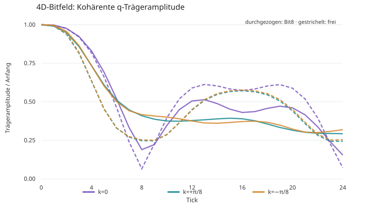

# Bit-Test 19 — Rückkehr zur phasenstrukturierten 4D-Paketphysik

Stand: 10. November 2026. Ausgangspunkt: Bit 6 (frühere asymmetrische Kollision), Bit 8/10 (reversible B4-symmetrische lokale Kollision), Bit 13 (Engine-Cache deaktivieren), Bit 18 (ballistische Ausbreitung lokaler Störungen und periodische Sättigung).

## Kernergebnis

**Positiv, auf der untersuchten endlichen Box:** Eine kohärente vierfach quadraturkodierte Dichteantwort ist auf der einzelnen `w=0`-Schicht und im Kontrollkanal des verborgenen Fouriermodus `q` sichtbar. Die zwei entgegengesetzten sichtbaren Träger haben im frühen Fenster entgegengesetzte Schwerpunktsbewegungen. Die Symmetrieprüfung ist für *exakt räumlich gespiegelte Mikrozustände* bitgenau bestanden, inklusive Umkehrung.

**Negativ / offen:** Die räumliche Intensitätsbreite wächst bereits in 24 Ticks erheblich. Weder ein gebundenes, stabiles 4D-Teilchen noch eine präzise Dispersion oder eine validierte Gruppengeschwindigkeit wurde nachgewiesen. Die getrennt mit zwei Seeds erzeugten `+k`- und `-k`-Ensembles sind nicht exakt gespiegelte Anfangsstichproben; die numerisch leicht unterschiedlichen Antworten dürfen **nicht** als Rest-Symmetriebruch interpretiert werden. Späte Schwerpunktsfits sind auf dem kleinen periodischen Torus instabil.

**Unverändert:** Die Mikrodynamik besteht vollständig aus 24 endlichen Bits pro gültigem D4-Knoten, der exakt symmetrischen Bit-8-Kollision und einer deterministischen Richtungspermutation. Komplexe Zahlen und die akustische Referenzdispersion werden nur bei Präparation bzw. Auswertung verwendet.

## 1. Wichtig: unabhängiger Nachbau, keine exakte Bit-6-Reproduktion

Der ursprüngliche `src/phase_bit_s4_open25.py`-Code und dessen Zahlenarrays gingen mit dem früheren Work-Lauf verloren. Verfügbar waren der ursprüngliche Bericht `RESULTS_Bit6_LocalPackets_de.md`, ältere Spektralexperimente und die neueren Quelltexte. Deshalb definiert Bit 19 ein **explizites, eigenes, reproduzierbares Präparationsprotokoll** nach dem dokumentierten Grundprinzip. Die ursprünglichen Seed-Nummern, Eigenvektoren und Schwellwertdetails sind **nicht** rekonstruiert; numerische Unterschiede zu Bit 6 lassen sich daher nicht ausschließlich der Kollisionsregel zuschreiben.

## 2. Präparation und Messkanäle

Die 4D-Box `(32,4,4,16)` besitzt genau **4.096 physische D4-Knoten**. Es wurden `k_x=0, +π/8, -π/8`, `q=π/8`, 24 Ticks, **zwei unabhängige Seeds je Träger**, pro Seed vier reale Präparationen untersucht. Das sind **24 echte kollidierende Trajektorien à 24 Schritte = 576 Vorwärtsticks**; zusätzlich 24 reine Freitransport-Trajektorien als identisch präparierte Kontrollen.

Die örtlich gaußförmige Präparation (sichtbare Breite `σ_x=5`) stellt für Richtung `j` und Vorzeichen `±` eine Belegungsschwelle proportional zu

\[
 p_j^{\pm,\alpha}(x,w)=\frac12 \pm A\,e^{-\Delta x^2/(2\sigma_x^2)}\cos(k_x\Delta x+qw-\alpha)
 \left[1+\sqrt{2}\,\frac{\mathbf v_j\cdot(k_x,0,0,q)}{\sqrt{k_x^2+q^2}}\right]
\]

bereit, mit `A=0.105`, `α=0,π/2`. Diese richtungsabhängige Anfangsgewichtung stammt aus der **positiven akustischen Referenz**, ist jedoch kein nachgewiesener Eigenmodus der Bit-8-Dynamik. An jedem Ort/Richtungsplatz wird eine vorab gesampelte **16-Bit-Ganzzahl** mit der Schwelle verglichen; die vier Präparationen eines Seeds verwenden *dieselben* Zufallszahlen. Danach folgen ausschließlich endliche Bitschritte ohne stochastische Übergänge.

Aus den vier reellen Dichteantworten bildet die **externe Messung** die Quadratur:

\[
 S=\tfrac12[(\rho_{c+}-\rho_{c-})+i(\rho_{s+}-\rho_{s-})].
\]

Die drei Messkanäle sind (i) `w=0`-Schicht, (ii) verborgener Fouriermodus `q` über die `w`-Perioden, und (iii) ungewichtetes `w`-Mittel. Die komplexe Postprozessantwort ist **kein komplexes Mikrouniversum**. Im direkten `w=0`-Kanal werden keine anderen verborgenen Schichten benutzt, allerdings werden vier separate reelle Versuche extern kombiniert.

## 3. Beobachtete Antwort (nur zwei Seeds: deskriptiv)

| Modus | Anfangsamplitude `w=0` | Anfangsamplitude `q` | Anfangsamplitude `w`-Mittel | `q`-Amplitude t=24 / t=0: Bit 8 | gleiche freie Kontrolle | `q`-Breite t=0 → t=24 |
|---|---:|---:|---:|---:|---:|---:|
| `k=0` | 14.59 | 14.24 | 0.23 | 0.154 | 0.072 | 3.57 → 5.77 |
| `k=+π/8` | 14.14 | 14.39 | 0.19 | 0.293 | 0.244 | 3.55 → 6.48 |
| `k=-π/8` | 14.03 | 14.16 | 0.09 | 0.319 | 0.254 | 3.57 → 6.05 |

Die Anfangsamplitude des ungewichteten `w`-Mittels liegt nur bei rund **0,7–1,6 %** der `q`-Trägeramplitude. Das ist konsistent mit dem Wegmitteln einer nichtkonstanten versteckten Mode. Bei späteren Ticks bleibt das Wegmitteln nicht streng null; ob das echte Modenkopplung oder endliche Ensemblefluktuationen zeigt, ist mit zwei Seeds offen. Der ungewichtete Kanal ist **keine neue physikalische 3D-Mikrodynamik**.

Die Breite ist ein Intensitätsmaß der *Ensembleantwort*, nicht ein mikroskopischer Teilchenradius. Die Demodulationsamplitude schwankt nichtmonoton; deshalb wird aus zwei Seeds kein Dämpfungskoeffizient geschätzt. Das restliche Ruhepaketsignal bei t=24 ist zudem im Verhältnis zur Seed-Streuung nur schwach aufgelöst (heuristisches Leistungsverhältnis ca. 2.8, keine Signifikanzgarantie).



## 4. Frühbewegung und Frequenzen

**Deskriptiver Schwerpunktfit nur auf Ticks 2..8**, *kein* robuster Gruppengeschwindigkeitsfit:

| Modus | frühe `q`-Schwerpunktssteigung | frühe `w=0`-Steigung | frühe q-Phasensteigung [rad/tick] | akustische Referenz `ω_ref` |
|---|---:|---:|---:|---:|
| `k=0` | −0.102 | −0.073 | −0.319 | 0.278 |
| `k=+π/8` | +0.571 | +0.161 | −0.408 | 0.393 |
| `k=-π/8` | −0.586 | −0.256 | −0.418 | 0.393 |

Referenz: `ω_ref=√((k²+q²)/2)` und `v_g,ref=k/[√2√(k²+q²)]`, also für `±k` nominal `±0.500`. Diese Anfangsreferenz **ist nicht die Kollisionsdispersion**. Die freien Kontrollen besitzen im frühen Fenster bereits Phasensteigungen von etwa `−0.406` und `−0.404` bei `±k`; die beobachteten Phasen sind daher **kein unabhängiger Nachweis einer neu entstandenen Masse**. Die `w=0`-Schwerpunktsbewegung ist deutlich stärker verrauscht als der `q`-Kontrollkanal.

Auf der nur 32 Stellen periodischen x-Achse werden längere Fits durch wandernde und interferierende Intensitätsanteile unzuverlässig. Die Werte eines vollen Fitfensters 4..24 werden **nicht** als physikalische Geschwindigkeit interpretiert.

## 5. Exakte Prüfungen

- Die Bit-8-Kollision und das Streaming sind nach der früheren Konstruktion B4-äquivariant. Eine zusätzliche *vollständige Orts-/Richtungs-Spiegelung x→−x* wurde auf 4.096 Knoten für fünf Vorwärtsticks und anschließende vollständige Umkehr **bitgenau** geprüft. In einem unabhängigen 512-Knoten-Smoke-Test zusätzlich zwei Seeds × drei Ticks.
- Die exakt fünf additiven konservierten Größen (Teilchenzahl und vier Impulskomponenten) wurden bei allen 24 kollidierenden Trajektorien an Anfang und Ende unverändert geprüft. Die bewiesene lokale Erhaltung ist ein struktureller Hintergrund; hier wurde **nicht** eine erneute 2²⁴-Enumeration durchgeführt.
- Die freien Kontrollen beginnen mit exakt derselben Präparation und haben keine Kollision.
- Der Engine-Cache ist deaktiviert; die beiden lokal begrenzten Bit-10-Funktions-Caches werden benutzt. Die probabilistische Präparation ist strikt vor dem ersten Tick abgeschlossen.

## 6. Beziehung zur Schalen-/Projektionsidee

Ein einzelner `w=0`-Beobachter sieht bei phasenstrukturierten Präparationen eine deutliche kollektive Antwort; ein ungewichtetes Mittel über verborgene Richtungen unterdrückt den anfänglichen `q`-Träger. Das ist ein **konkretes Projektionsphänomen D4→sichtbare 3D-Schicht**, aber noch keine dynamische Rückkopplung des 3D-Schnitts auf D4. Ebenso wenig ergibt sich daraus ein D4↔D8-Mechanismus.

Die Schalenexperimente 14–18 zeigten, dass einfache Kugeloberflächen unter aktiven Kollisionen nicht geschlossen bleiben. Das Paketexperiment zeigt, dass eine gezielt gerichtete und phasenkodierte Ensembleanregung in diesen gleichen Mikrorichtungen trotzdem kohärente Moden produzieren kann. **Zusammenhängende Frage für Bit 20:** Gibt es bei vollständiger 3D-Lokalisierung und größerer Periodenlänge eine kleinere Familie von richtungs-/phasenorganisierten Fronten, die langsamer zerstreut als unspezifische Störungen?

## 7. Grenzen und nächste harte Prüfung

1. Nur **zwei** unabhängige Seeds pro `k` und nur 24 Ticks. Keine präzisen Fehlerbalken, keine belastbare Lebensdauer, keine zuverlässige Gruppengeschwindigkeit.
2. `(32,4,4,16)` ist ein stark verkürzter Torus. Vor allem die `y`-/`z`-Perioden 4 führen früh zu Mehrfachwegen; nicht mit einem ausgedehnten unendlichen Raum verwechseln.
3. Weder vollständige isotrope 3D-Lokalisierung noch spontane Einzelversuchs-Detektierbarkeit getestet. Die Ausdehnung ist weiterhin nur in `x` begrenzt, in `y,z` homogen.
4. Die alte Bit-6-Präparation ist nicht exakt rekonstruiert. Quantitative Werte zwischen Bit 6 und Bit 19 sind nicht unmittelbar vergleichbar.
5. Der bessere späte kohärente Trägerwert gegenüber freiem Streaming ist ein **endliches Messresultat**, keine Garantie einer stabilen Wechselwirkung, eines gebundenen Pakets oder einer neuen Dispersion.

**Empfohlener Folgetest:** Bei **≥8 Seeds** auf einer längeren sichtbaren x-Periode die `+k/-k`-Antwort mit gespiegelten und unabhängig erzeugten Ensembles *gepaart* vergleichen; Präparation und Messwerte bei `q=0` und `q≠0` kontrollieren; längere Messzeiten nur mit ausreichendem Abstand zur periodischen Rückkehr. Danach 3D-begrenzte Hüllkurve, ggf. GPU/Numba-Kollisionsbeschleunigung.

## Reproduktion

```bash
OPENBLAS_NUM_THREADS=1 OMP_NUM_THREADS=1 python src/phase_bit_s4_open38_validate.py
OPENBLAS_NUM_THREADS=1 OMP_NUM_THREADS=1 python src/phase_bit_s4_open38_phased_packet.py --shape 32 4 4 16 --ticks 24 --seeds 2 --out data/bit19_phasecoded_main.json
python src/phase_bit_s4_open38_analyze.py --input data/bit19_phasecoded_main.json --summary data/bit19_summary.json --figure figures/bit19_q_packet_amplitude.svg
```

Ausgaben: `data/bit19_phasecoded_main.json` (alle gemittelten Zeitserien; 84 KB), `data/bit19_summary.json`, `data/bit19_validation.json`, `figures/bit19_q_packet_amplitude.svg` und dieser Bericht. Rechenlauf in der untersuchten Umgebung ca. 232 s; abhängig von CPU und Funktions-Caches.