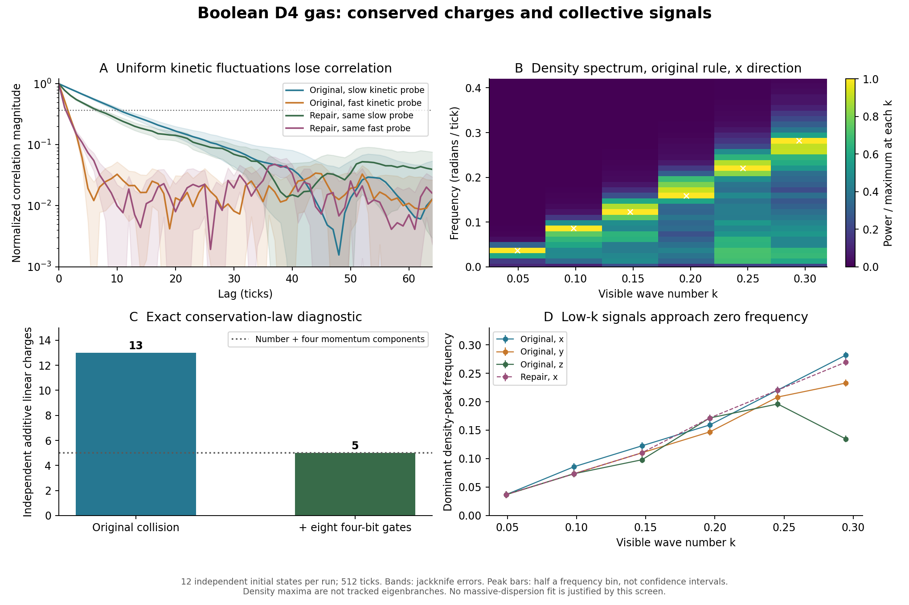

# Bit-Test 4: Kollektive Wellen, zusätzliche Erhaltungsgrößen und eine Bit-Reparatur

Stand: 8. November 2026. Vorgänger: [Bit-Test 3](RESULTS_Bit3_HiddenLayers_de.md).

- Code: [`phase_bit_s4_open23.py`](../src/phase_bit_s4_open23.py)
- Zahlen: [`phase_bit_s4_open23.json`](../data/phase_bit_s4_open23.json)
- Korrelationsfunktionen und Spektren: [`phase_bit_s4_open23.npz`](../data/phase_bit_s4_open23.npz)
- Abbildung: [`phase_bit_s4_open23.png`](../figures/phase_bit_s4_open23.png)
- Reproduktion: `python src/phase_bit_s4_open23.py`, danach `python src/phase_bit_s4_open23_figs.py`.

## Fragestellung und Ergebnis

Trägt das vollständig reversible D4-Bitgas auf einem besetzten Hintergrund langlebige
kollektive Wellen, insbesondere eine massiveartige Mode mit einer endlichen Frequenz
bei verschwindender sichtbarer Wellenzahl?

**EXAKT:** Der ursprüngliche Automat hat 13 unabhängige globale additive Erhaltungsgrößen,
die linear in den Richtungsbesetzungen sind. Teilchenzahl und vierdimensionaler Impuls
erklären davon nur fünf. Die acht zusätzlichen Richtungsgrößen sind eine Einschränkung
der gewählten Kollisionsregel, keine notwendige Eigenschaft von D4.

**EXAKT:** Acht zusätzliche konservative Vier-Bit-Gatter beseitigen diese acht
Zusatzgrößen. Die verbesserte Kollisionsregel hat in derselben Klasse genau fünf
Erhaltungsgrößen. Sie bleibt bijektiv und benötigt weiterhin nur 24 Bits pro Knoten.

**NUMERISCH:** In der ursprünglichen Regel entstehen Dichtewellensignale mit kleinen
Frequenzen bei kleinen Wellenzahlen. Die untersuchten räumlich homogenen kinetischen
Observablen verlieren ihre Korrelation dagegen in etwa 2 bis 12 Ticks. Keine der fünf
untersuchten kinetischen Proben erfüllt den verwendeten Test auf eine aufgelöste,
schmalbandige und mindestens eine Periode überdauernde Schwingung. Das gilt für die
drei sichtbaren Achsen der ursprünglichen Regel sowie für dieselben fünf Proben in
einem ersten x-Lauf der verbesserten Regel.

**Nicht gezeigt:** Eine massive relativistische Dispersion, Isotropie der verbesserten
Regel, eine Eigenzeitdynamik oder Gravitation. Die negative Modensuche ist endlich und
beobachtungsabhängig; sie ist kein Ausschlusssatz für alle Zustände oder Observablen.



## 1. Exakte Diagnose der zusätzlichen Erhaltungsgrößen

Sei a eine der zwölf ungerichteten D4-Achsen mit Richtungsvektoren v_a und -v_a.
Die ursprüngliche Kollision verschiebt nur volle Gegenrichtungspaare. Deshalb bleiben
alle Größen

\[
Q_a=\sum_x\bigl(n_{x,+a}-n_{x,-a}\bigr),\qquad a=1,\ldots,12
\]

erhalten. Hinzu kommt die Gesamtteilchenzahl N. Der vierdimensionale Gitterimpuls ist

\[
P_i=\sum_a (v_a)_i Q_a,\qquad i=1,\ldots,4.
\]

Er enthält nur vier unabhängige Kombinationen der zwölf Q_a. Es verbleiben acht
zusätzliche Richtungsströme. Die Kontinuitätsgleichungen eines gewöhnlichen Gases
wären damit um zusätzliche langsame Variablen zu erweitern. Ein Dispersionsfit ohne
diese Diagnose könnte solche Gaskinetik fälschlich als neue Teilchenphysik deuten.

Die Vollständigkeit wurde für die Klasse räumlich homogener additiver linearer
Besetzungsgrößen exakt bestimmt. Dazu werden alle 2325 lokalen Zustände mit null bis
drei besetzten Kanälen durch die **gesamte zusammengesetzte Kollision** geschickt.
Die Änderungsvektoren haben über den rationalen Zahlen Rang 11. Da die 13 benannten
Erhaltungsgrößen für jeden lokalen Zustand gelten, ist die Nullraumdimension exakt
24 - 11 = 13. Nichtlineare, topologische oder ortsabhängige Invarianten sind damit
nicht vollständig klassifiziert.

Wichtig: Der Rang der einzelnen Gatter allein wäre kein hinreichender Nachweis für
die zusammengesetzte Kollision. Bereits die Zweiteilchenzustände liefern hier nur
Rang 8; die zusätzlichen Dreiteilchenzustände liefern den notwendigen Rang-11-Zeugen.

## 2. Reparatur ohne neue Register und ohne kontinuierliche Parameter

D4 erlaubt Zweiteilchenstreuung auch bei nichtverschwindendem Gesamtimpuls. Ein Beispiel:

\[
(-1,1,0,0)+(-1,-1,0,0)
=(-1,0,1,0)+(-1,0,-1,0).
\]

Alle vier Vektoren sind nächste D4-Nachbarn. Ein Gatter auf den vier zugehörigen
Besetzungsbits vertauscht genau die Muster `1100` und `0011`; die übrigen 14 Muster
bleiben unverändert. Die Regel lautet ausschließlich:

```
eligible = (b0 == b1) AND (b2 == b3) AND (b0 != b2)
out[j] = b[j] XOR eligible        für j = 0,1,2,3
```

Die beiden Muster haben dieselbe Teilchenzahl und denselben Gitterimpuls. Das Gatter
ist selbstinvers. Die Nachbarrichtungen sind feste Geometriedaten, keine reellen
dynamischen Register.

Aus allen solchen D4-Streuungen werden durch exakte rationale Rangprüfung acht
unabhängige zusätzliche Gatter ausgewählt. Ihre Kanalindizes sind in der JSON-Datei
und im reproduzierenden Auswahlalgorithmus festgehalten. Die **volle** reparierte
Kollision erreicht auf den 2325 Testzuständen Änderungsrang 19. Die fünf bekannten
Erhaltungsgrößen gelten zugleich auf dem gesamten Zustandsraum. Damit ist die
Dimension dieser linearen Invariantenklasse exakt 24 - 19 = 5.

| Variante | Änderungsrang der vollen lokalen Kollision | Lineare Erhaltungsgrößen | Zusätzlich zu N und P |
|---|---:|---:|---:|
| Ursprüngliche Regel | 11 | 13 | 8 |
| Mit acht Vier-Bit-Gattern | 19 | 5 | 0 |

Alle 16 Vier-Bit-Zustände wurden vollständig auf Bijektivität, Selbstinversion,
Teilchenzahl und Impuls geprüft. Zusätzlich wurden für jede Variante acht dichte
Gesamtzustände je 16 Ticks vorwärts und rückwärts entwickelt: bitgenaue Wiederherstellung,
Teilchenzahlfehler 0, Impulsfehler 0.

Die Reihenfolge der Gatter ist weiterhin eine feste und willkürliche Auswahl.
Die stärkere Schalensymmetrie von D4 ist damit noch keine Symmetrie der Dynamik.
Auch werden hier keine materiellen Energien oder die Born-Regel aus N identifiziert.

## 3. Exakte Ein-Schritt-Projektion, nicht fundamentale Markov-Physik

Als Kontrollrechnung wird die lineare Antwort einer lokalen Kollision im stationären
Ensemble gleich gewichteter Bitzustände berechnet. Definiere pro Gegenrichtungspaar

\[
p_a=n_{+a}+n_{-a}-1,\qquad q_a=n_{+a}-n_{-a}.
\]

Bei halber Besetzung hat jedes Paar mit Anteil 1/2 entweder die Form 00/11 oder 01/10.
In der ursprünglichen Kollision bleibt diese Zugehörigkeit unverändert. Für einen
festen Zwölf-Bit-Zugehörigkeitszustand werden die p_a nur permutiert. Deshalb lässt
sich die lokale Ein-Schritt-Antwort M exakt durch Aufzählung aller 4096 Zustände
berechnen. Ihre Einträge sind ganzzahlige Häufigkeiten geteilt durch 2048; Zähler und
Nenner sind vollständig gespeichert. Die q_a bleiben bei der lokalen Kollision unverändert.

**Diese Brüche sind Analysegrößen. Kein mikroskopischer Knoten zieht einen Zufallswert
oder berechnet eine Übergangswahrscheinlichkeit.** Die tatsächliche Simulation führt
die Bit-Gatter aus und verwendet M nicht. Wiederholtes Anwenden von M würde entstehende
Korrelationen verwerfen und wäre eine Gedächtnis vernachlässigende Näherung.

Die fünf komplexen Eigenwertpaare dieser Ein-Schritt-Projektion sind schwach bis stark
gedämpfte Referenzsignale. Mit lambda = exp(-Gamma + i omega) ergibt sich:

| Referenzprobe | omega pro Tick | Gamma pro Tick | Perioden bis zum Abfall um 1/e |
|---|---:|---:|---:|
| 0 | 0,00794 | 0,10419 | 0,0121 |
| 1 | 0,12533 | 0,41334 | 0,0483 |
| 2 | 0,28407 | 0,61442 | 0,0736 |
| 3 | 0,35290 | 0,87237 | 0,0644 |
| 4 | 0,35342 | 0,83699 | 0,0672 |

Selbst die günstigste dieser Näherungsmoden fällt vor einem Zehntel einer Periode
um 1/e ab. Ein reeller Frequenzoffset allein wäre deshalb keine tragfähige Masse.
Ob tatsächliche Gedächtniseffekte diese Einschätzung ändern, wird getrennt anhand
der mikroskopischen Trajektorien untersucht.

## 4. Mikroskopische Messung

Vier Läufe: ursprüngliche Regel entlang x, y und z; reparierte Regel zunächst entlang x.
Je Lauf gelten:

- Lange Richtung: 128 Zellen; die übrigen drei Raumrichtungen haben jeweils vier Zellen.
- 4096 physische D4-Knoten und 98304 dynamische Bits.
- Zwölf unabhängige vorbereitete Bitzustände, 512 Entwicklungsticks plus Anfangszustand.
- Hintergrundensemble: halbe Besetzung. Der Generator erzeugt nur die Anfangsbits;
  die Entwicklung ist danach vollständig deterministisch. Es wurde keine Besetzungsreihe untersucht.
- Das Produktensemble bei halber Besetzung ist stationär: Die globale Bitentwicklung
  ist eine Permutation aller gültigen Konfigurationen. Ein Gleichgewicht wird nicht
  durch nachträgliche Zufallskollisionen oder Normierung erzwungen.
- Gemessen werden zuerst ganzzahlige Richtungsbesetzungen pro Längsschicht. Über die
  beiden anderen sichtbaren Richtungen und w wird summiert. Fourierwerte und
  Korrelationsfunktionen werden erst in der Auswertung daraus berechnet.

Untersucht werden sechs sichtbare Wellenzahlen k_m = 2 pi m / 128, m=1,...,6, sowie k=0.
Die Winkelauflösung wird hier nicht getestet. Die Frequenzrasterweite beträgt
2 pi / 513 = 0,0122479 pro Tick. Die zeitlichen Spektren verwenden ein Hann-Fenster.
Korrelationsfunktionen werden über alle verfügbaren Zeitursprünge bis Lag 128
gemittelt. Fehler werden durch Weglassen ganzer unabhängiger Läufe abgeschätzt;
korrelierte Zeitursprünge werden nicht als unabhängige Stichproben ausgegeben.

In allen 48 Trajektorien, insgesamt 24576 Vorwärtsticks, bleiben N und P exakt erhalten.
In der alten Regel bleiben auch alle zwölf Q_a exakt konstant. In der reparierten
Regel ändern sich einzelne Q_a tatsächlich (größte gemessene Änderung 224), während
ihre vier Impulskombinationen erhalten bleiben. Die Reparatur wirkt somit auch in
dichten Trajektorien und nicht nur in isolierten Wahrheitstabellen.

## 5. Kollektive Signale

Die fünf kinetischen Proben sind die linken Eigenvektoren der ursprünglichen
Ein-Schritt-Antwort, als lineare Beobachtungen der tatsächlich simulierten p_a.
Für die reparierte Regel werden zunächst **dieselben** Proben verwendet; sie sind
dort keine nachgewiesenen Eigenmoden. Die übrigen relaxierenden Freiheitsgrade der
reparierten Kollision sind damit noch nicht vollständig spektral untersucht.

### Räumlich homogene kinetische Proben

Erster Lag mit normierter Korrelationsstärke unter 1/e:

| Probe | Original x | Original y | Original z | Reparatur x |
|---|---:|---:|---:|---:|
| 0 | 11 | 11 | 12 | 7 |
| 1 | 3 | 3 | 3 | 2 |
| 2 | 2 | 2 | 2 | 2 |
| 3 | 2 | 2 | 2 | 1 |
| 4 | 2 | 2 | 2 | 1 |

Diese Zeiten sind Korrelationsdauern von Observablen, keine Lebensdauern fundamental
erzeugter Teilchen. Ihre Kürze stimmt qualitativ mit den gedämpften Referenzsignalen
überein. Die gemessenen C(1) weichen vom exakten Ensemblewert der ursprünglichen Regel
um höchstens 0,0152 / 0,0186 / 0,0179 (x/y/z) ab; die gespeicherten Jackknife-Fehler
liegen je nach Probe ungefähr zwischen 0,004 und 0,015. Eine exakte Übereinstimmung
jeder einzelnen endlichen Stichprobe wird nicht behauptet.

Ein vorab im Skript festgelegtes Screening verlangt gemeinsam: einen Peak mehr als
vier Frequenzbins von null entfernt, Peakfrequenz/Halbwertsbreite mindestens drei
und Korrelationsstärke über 1/e nach einer ganzen Peakperiode. Keine der 20 untersuchten
Probe/Lauf-Kombinationen besteht es. Breiten einzelner ungeglätteter Spektralmaxima
sind dabei nur Diagnosewerte; aus ihnen wird keine präzise Teilchenmasse bestimmt.

### Dichtewellen bei kleinen Wellenzahlen

Dominante Spektralmaxima, Frequenzen pro Tick:

| k | Original x | Original y | Original z | Reparatur x |
|---:|---:|---:|---:|---:|
| 0,04909 | 0,03674 | 0,03674 | 0,03674 | 0,03674 |
| 0,09817 | 0,08574 | 0,07349 | 0,07349 | 0,07349 |
| 0,14726 | 0,12248 | 0,11023 | 0,09798 | 0,11023 |

Das ist mit schallartigen, lückenlosen kollektiven Signalen vereinbar. Bei k=0 ist
die Gesamtdichte exakt konstant. Eine vollständige Dispersionsherleitung oder ein
kontrollierter k->0-Grenzwert folgt aus diesen drei kleinen Wellenzahlen nicht.
Bei größeren k unterscheiden sich die Achsen und die dominanten Maxima deutlich.
Die Maxima sind keine kontinuierlich verfolgten Eigenzweige. Deshalb wird ausdrücklich
**kein Fit omega² = m² + c² k²** aus ihnen erzeugt.

Das vorübergehende Abklingen einer beobachteten Korrelation ist keine Vernichtung
mikroskopischer Information. Die Bitabbildung bleibt auch im dichten Hintergrund
bijektiv; eine reduzierte Beobachtung kann Information in anderen Korrelationen verlieren.

## 6. Grenzen und nächster sinnvoller Schritt

Der konkrete Fortschritt ist eine streng konservative Bit-Regel mit dem beabsichtigten
linearen Erhaltungssatz, bei unverändertem lokalen Speicherbedarf. Die Daten liefern
weiterhin keinen belastbaren massiven kollektiven Zweig.

Folgende Grenzen bleiben ausdrücklich bestehen:

1. Alle Spektralmessungen sehen die über w summierte Beobachtung, also k_w=0. Nichtkonstante
   verborgene Raummoden werden durch diese lineare Sicht ausgemittelt. Für eine
   Kaluza-Klein-artige Hypothese müssen eine andere Beobachtung/Kopplung und längere
   kompakte Richtungen separat getestet werden.
2. Die reparierte Regel wurde zunächst nur entlang x und nur mit den fünf ursprünglichen
   kinetischen Proben untersucht. Ihre vollständige 19-dimensionale relaxierende
   lineare Beobachtungsklasse und nichtlineare gebundene Strukturen sind offen.
3. Die feste Gatterreihenfolge bricht Rotationssymmetrie. Ein äquivariantes Gesetz oder
   ein mitgezählter endlicher Orientierungszustand wäre ein eigener Entwicklungsschritt.
4. Es gibt einen gemeinsamen Tick. Unterschiedliche lokale Ereignisraten, universeller
   freier Fall und die Vermeidung des Parkstaus aus Bit-Test 2 sind nicht gelöst.
5. Nur halbe Besetzung, eine kompakte Periodenlänge und endliche Beobachtungszeiten
   wurden im Hauptlauf geprüft. Das negative Ergebnis gilt für diesen Testumfang.

**Nächster gezielter Test:** Die reparierte Kollision mit allen linearen kinetischen
Observablen und explizit aufgelösten verborgenen Moden untersuchen. Dabei zunächst
prüfen, ob verborgene Anregungen propagieren, relaxieren oder nur eine endliche
Umlaufphase tragen. Erst bei einem langlebigen Zweig sind Branch-Tracking, dessen
Krümmung und ein Wellenpakettest sinnvoll. Ein Sprung auf E8 wäre vorher nicht durch
einen dynamischen Befund begründet.
