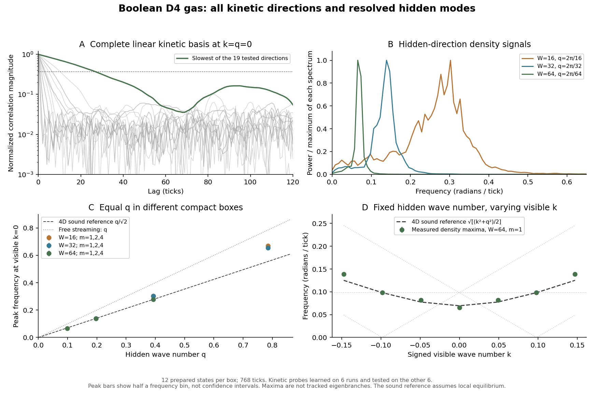

# Bit-Test 5: Alle kinetischen Richtungen und aufgelöste verborgene Raummoden

Stand: 8. November 2026. Vorgänger: [Bit-Test 4](RESULTS_Bit4_CollectiveModes_de.md).

- Simulation und Prüfungen: [`phase_bit_s4_open24.py`](../src/phase_bit_s4_open24.py)
- Zahlen: [`phase_bit_s4_open24.json`](../data/phase_bit_s4_open24.json)
- Korrelationen und Spektren: [`phase_bit_s4_open24.npz`](../data/phase_bit_s4_open24.npz)
- Abbildung: [`phase_bit_s4_open24.png`](../figures/phase_bit_s4_open24.png)
- Reproduktion: `python src/phase_bit_s4_open24.py`, danach `python src/phase_bit_s4_open24_figs.py`.
- Schnelle Prüfung der gepackten Bit-Regel: `python src/phase_bit_s4_open24.py --validate-only`.

## Ergebnis und Einordnung

**NUMERISCH / positiv:** Die reparierte D4-Bit-Regel trägt in der aufgelösten verborgenen
Raumrichtung kollektive Dichtesignale. Bei festem nichtverschwindendem verborgenem
Wellenvektor q besitzen geeignete Signale in der sichtbaren Richtung eine Frequenzlücke.
Fünf benachbarte, hinreichend langlebige Spektralmaxima sind mit

\[
\omega^2\simeq\omega_0(q)^2+c_{\rm eff}^2 k^2
\]

vereinbar. Bei kleinerem q wird die Lücke kleiner. Gleiche q in zwei verschieden
großen kompakten Boxen liefern für den gut aufgelösten Fall dieselbe Peakfrequenz.

Das ist ein positives Architekturresultat innerhalb dieser Testreihe: Eine reine
endliche Bit-Dynamik kann nach Auflösung einer verborgenen Raumrichtung eine
massiveartige sichtbare Dispersionsform tragen. Das passende Referenzbild ist
**klassischer vierdimensionaler Schall mit kompakter Raumrichtung**. Es besteht kein
Neuheitsanspruch für den Kompaktifizierungsmechanismus selbst.

**NUMERISCH / negativ im Testumfang:** Bei k=q=0 besteht keine der 19 linear unabhängigen
kinetischen Proben den festgelegten Test auf eine aufgelöste, schmalbandige und
mindestens eine Periode überdauernde Schwingung. Die vorher fehlenden Freiheitsgrade
wurden einbezogen. Das ist kein Ausschluss nichtlinearer, schwacher oder anders
präparierter Anregungen.

**Nicht gezeigt:** Quantenmechanik, Born-Regel, physikalische Teilchenmasse, Spin,
emergente Zeit oder Gravitation. Auch die Gruppengeschwindigkeit eines lokalisierten
Pakets und eine rein lokale 3D-Detektorkopplung sind noch nicht getestet.

## 1. Unveränderte mikroskopische Physik, andere Speicherung

Verwendet wird genau die reparierte Regel aus Bit-Test 4: 24 boolesche Besetzungen pro
D4-Knoten, die alten Paargatter und die acht zusätzlichen konservativen Vier-Bit-Gatter.
Die Zahl räumlicher Dimensionen ist vier; ein gemeinsamer Aktualisierungstick bleibt
als Zeit vorausgesetzt.

Für größere kompakte Richtungen speichert `PackedD4` die 24 variablen Bits in einem
`uint32`-Wort. Die acht unbenutzten Bits bleiben null. Kollision und Transport verwenden
nur ganzzahlige Bitoperationen, feste Indexpermutationen und boolesche Bedingungen.
Es gibt keine Fließkommaamplitude, keinen reellen Coin-Winkel und keine Zufallswahl im
Update. Der Zufallsgenerator liefert ausschließlich vorbereitete Anfangskonfigurationen.

Die gepackte Umsetzung wurde an zwei Boxformen und acht dichten Anfangszuständen gegen
die boolesche Referenz geprüft:

- 128 Vorwärtsticks: vollständige Übereinstimmung sämtlicher Besetzungsbits;
- gleichzeitig exakte Übereinstimmung der nach y,z summierten Richtungszählungen;
- acht vollständige Rückläufe nach jeweils 16 Vorwärtsticks: bitgenaue Wiederherstellung;
- unbenutzte Wortbits in jedem geprüften Schritt null.

Das ist eine Implementierungsprüfung, keine Änderung der Kollisionsphysik. Die zuvor
bewiesene Bijektivität und die fünf additiven linearen Erhaltungsgrößen bleiben bestehen.

## 2. Versuchsaufbau

Die Formen sind `(128,4,4,W)` mit W=16,32,64 und periodischen Randbedingungen.
Die gerade Koordinatensumme definiert wie bisher die physischen D4-Knoten.

| W | Physische Knoten | Variable Bits | Vorbereitete Zustände | Ticks je Zustand |
|---:|---:|---:|---:|---:|
| 16 | 16384 | 393216 | 12 | 768 |
| 32 | 32768 | 786432 | 12 | 768 |
| 64 | 65536 | 1572864 | 12 | 768 |

Das Hintergrundensemble ist das stationäre Produktensemble bei halber Besetzung.
Jede realisierte Konfiguration ist eine endliche konkrete Bitfolge; nach der Vorbereitung
ist die gesamte Entwicklung deterministisch. Teilchenzahl und vierdimensionaler
Gitterimpuls bleiben in sämtlichen **27648 Vorwärtsticks** exakt erhalten.

Zunächst werden ausschließlich ganzzahlige Richtungsbesetzungen

\[
n_d(x,w,t)=\sum_{y,z}n_d(x,y,z,w,t)
\]

gezählt. Die komplexen Fourierwerte werden daraus erst für die Auswertung berechnet.
Sie sind weder Zustände des Knotenautomaten noch Übergangswahrscheinlichkeiten.

Sichtbare Wellenzahlen: `k=2*pi*m_x/128`, m_x=-3,...,3. Verborgene Wellenzahlen:
`q=2*pi*m_w/W`, m_w=0,+/-1,+/-2,+/-4. Das sind je Box 49 Auswertungspunkte;
konjugierte Vorzeichenpaare sind keine unabhängigen statistischen Experimente.
Die Frequenzrasterweite ist `2*pi/769 = 0,00817059` pro Tick.

Die Spektren verwenden Hann-Fenster. Korrelationsfunktionen werden über Zeitursprünge
bis Lag 384 gemittelt. Jackknife-Fehler verwenden ganze unabhängige Anfangszustände
als Stichprobeneinheiten. Halbe Frequenzbins in der Abbildung kennzeichnen nur die
Rasterweite, keine statistischen Konfidenzintervalle. Die gespeicherten NPZ-Analysearrays
sind platzsparend float32/complex64; die Analyse und die JSON-Zahlen entstehen mit
doppelter Genauigkeit. Die Bit-Dynamik selbst ist davon unabhängig und exakt.

## 3. Vollständige lineare kinetische Beobachtungsklasse

Die fünf Koeffizientenvektoren von Teilchenzahl und den vier Impulskomponenten werden
aus dem 24-dimensionalen Raum der Richtungsbesetzungen entfernt. Ihr orthogonales
Komplement ist 19-dimensional. Orthogonalität und Restfehler werden numerisch auf
weniger als 1e-12 geprüft; die exakte Dimension folgt aus Bit-Test 4.

Für jede Box werden die ersten sechs Trajektorien benutzt, um eine Ein-Schritt-
Beobachtungsprojektion in diesem Raum zu schätzen. Ihre linken Eigenvektoren bilden
die 19 Proben. Sie werden danach festgehalten und ausschließlich an den anderen sechs
Trajektorien spektral geprüft. Die komplexen Probenmatrizen besitzen Rang 19; ihre
Konditionszahlen sind etwa 15,03 / 11,75 / 11,54 (W=16/32/64).

Diese empirische Projektion ist **keine** neue Mikrodynamik und keine exakte Markov-
Schließung. Sie dient nur zur Wahl einer vollständigen linearen Beobachtungsbasis.
Eine beliebige weitere Linearkombination, nichtlineare Anregungen und alle denkbaren
Anfangsbedingungen werden durch 19 einzelne Spektren nicht vollständig ausgeschlossen.

Das Screening verlangt gemeinsam:

1. Peakfrequenz mehr als vier Frequenzbins von null entfernt;
2. Peakfrequenz/Halbwertsbreite mindestens drei;
3. normierte Korrelationsstärke nach einer ganzen Peakperiode größer als 1/e.

| W | Geprüfte kinetische Richtungen | Bestandene Tests | Erster Abfall unter 1/e, Bereich |
|---:|---:|---:|---:|
| 16 | 19 | 0 | 1 bis 31 Ticks |
| 32 | 19 | 0 | 1 bis 37 Ticks |
| 64 | 19 | 0 | 1 bis 27 Ticks |

Die langsamen Proben zeigen teilweise spätere Korrelationsreste oder Wiederanstiege.
Es wird deshalb kein rein exponentielles vollständiges Vergessen behauptet. Der
negative Befund betrifft den festgelegten langlebigen Schwingungstest und ist kein
allgemeiner Ausschluss einer Frequenzlücke bei anderen Observablen.

## 4. Aufgelöste verborgene Dichtewellen

Für die Dichtesignale wird zusätzlich die Kohärenz mit dem Strom in Richtung `(k,0,0,q)`
berechnet. Das zusätzliche Screening verlangt eine normierte spektrale Dichte-Strom-
Kohärenz von mindestens 0,8. Diese Kohärenz ist wesentlich durch Kontinuität geprägt;
sie allein beweist weder einen neuen Teilchentyp noch Quantenkohärenz.

Bei sichtbarem k=0:

| W | m_w | q | Dichte-Peak omega | Korrelation nach einer Periode | Bestanden |
|---:|---:|---:|---:|---:|---|
| 16 | 1 | 0,39270 | 0,30231 | 0,363 | nein |
| 32 | 1 | 0,19635 | 0,13890 | 0,545 | ja |
| 64 | 1 | 0,09817 | 0,06536 | 0,623 | ja |
| 64 | 2 | 0,19635 | 0,13890 | 0,609 | ja |

Der knapp verfehlte Test bei W=16 wird nicht nachträglich als bestanden umgedeutet.
Die beiden gut aufgelösten Fälle mit **gleichem q=0,19635** haben trotz verschiedener
Boxgrößen dieselbe Peakfrequenz 0,13890. Bei halbiertem q verschiebt sich der Peak nach
unten. Größere q zeigen stärkere Abweichungen, breite oder mehrdeutige Maxima. Beispielsweise
liegen die Maxima bei q=0,39270 je nach Box bei 0,27780 bis 0,30231; eine universelle
hochfrequente Dispersionskurve wird daraus nicht behauptet.

Die positiven Signale sind keine bloßen zusätzlichen globalen Uhren. Sie tragen
räumlich definierte Wellenvektoren, koppeln an den Dichtestrom und ändern ihre sichtbare
Frequenz mit k. Ein direkter Wellenpakettransport bleibt dennoch eine notwendige
zusätzliche Prüfung.

## 5. Klassische Referenz: Schall plus kompakte Raumrichtung

Für die 24 D4-Richtungen gelten exakt

\[
\sum_d v_{d,i}v_{d,j}=12\delta_{ij},\qquad
\sum_d v_{d,i}v_{d,j}v_{d,k}=0.
\]

Unter der **zusätzlichen lokalen Gleichgewichtsannahme** für das konservative Bitgas
folgt in linearer Langwellen-Näherung

\[
\partial_t\delta N+\nabla\cdot\delta P=0,\qquad
\partial_t\delta P_i+\tfrac12\partial_i\delta N\simeq0,
\]

also `c_s²=1/2`. Diese Schließung setzt hinreichende lokale Durchmischung voraus;
Ergodizität und der gesamte hydrodynamische Grenzübergang wurden hier nicht bewiesen.
Sie liefert die vorab geometrisch bestimmte Referenz

\[
\omega^2\simeq\tfrac12(k^2+q^2),\qquad
q_m=\frac{2\pi m}{W}.
\]

Für festes q ungleich null ist das eine klassische massiveartige 3D-Dispersionsform:
`omega_0=|q|/sqrt(2)` und verschwindende sichtbare Gruppengeschwindigkeit bei k=0.
Es wird keine Planck-Konstante eingesetzt und keine Masse in Kilogramm identifiziert.

Als Gegenprobe sind die kollisionsfreien Phasen vollständig durch
`omega = k*v_x + q*v_w` gegeben, gegebenenfalls periodisch gefaltet. Sie sind affin
in k oder bei v_x=0 konstant. Ein verborgener Umlauftakt erzeugt darin keine
massiveartige positive Dispersionskrümmung. Im getesteten freien Phasenbereich ist
auch keine notwendige Floquet-Faltung verborgen.

## 6. Diagnostische Fits nach dem Lebensdauer-Screening

Ein Fit wird nur erzeugt, wenn alle fünf Punkte m_x=-2,-1,0,1,2 beim festen m_w
das Dichte-/Strom-Screening bestehen. Gefittet wird

\[
\omega^2=A+B k+C k^2,
\quad \omega_0=\sqrt A,
\quad v_g(0)=B/(2\sqrt A).
\]

| W | m_w | omega_0 im Fit | C | v_g(0) im Fit | Max. Frequenzrest, in Bins |
|---:|---:|---:|---:|---:|---:|
| 32 | +1 | 0,1388 | 0,5007 | -0,017 | 0,41 |
| 64 | +1 | 0,0707 | 0,4908 | 0,000 | 0,66 |
| 64 | +2 | 0,1359 | 0,5699 | 0,000 | 0,37 |

Die geometrische Referenz für die ersten beiden Lücken ist 0,13884 beziehungsweise
0,06942. Die Fits sind damit auf dem vorhandenen Frequenzraster vereinbar. Auch der
Koeffizient C liegt in der Nähe des Referenzwerts 1/2; für den zweiten q=0,19635-Lauf
weicht der Fit sichtbar stärker ab. Die angegebenen Nachkommastellen dokumentieren
die Rechnung und sind keine entsprechende physikalische Genauigkeit.

Insbesondere darf das numerische `v_g(0)=0` nicht als exaktes Resultat gelesen werden:
die Peakfrequenzen liegen auf einem Raster. Eine grobe Ableitungsauflösung aus
Rasterweite und kleinstem sichtbarem k liegt in der Größenordnung 0,08. Eine unabhängig
gemessene Paketgeschwindigkeit fehlt. Die Spektralmaxima wurden zudem nicht als
Eigenzweig durch einen vollständigen Propagator verfolgt. Die Fits sind deshalb
positive **Dispersionsdiagnosen**, keine abgeschlossene Massederivation.

Die negativen m_w liefern die gespiegelten Fits. Wegen der Konjugationsbeziehung
reeller Dichten sind das keine zusätzlichen unabhängigen Bestätigungen. Die
gesamte Vorzeicheninformation und alle verworfenen Fits stehen in der JSON-Datei.

## 7. Was eine 3D-Sicht tatsächlich beobachten würde

Die bisherige ungewichtete Summierung über w sieht nur m_w=0. Nichtkonstante verborgene
Moden verschwinden darin. Für diesen Test wird stattdessen die Fourierkomponente

\[
\Phi_m(x,t)=\sum_w e^{-iq_mw}\rho(x,w,t)
\]

analytisch aufgelöst. Diese Messoperation gehört bislang zum externen Auswerter.
Ein lokaler 3D-Beobachter, der genau diese Kopplung besitzt, wurde nicht konstruiert.

Eine natürliche andere Sicht ist die einzelne Schicht w=0: Sie hat wieder FCC-Geometrie
und enthält Beiträge aller verborgenen Fouriermoden, statt sie wegzumitteln. Dort
könnte ein endlicher Detektor eine entsprechend präparierte Anregung lokal messen.
Auch dieser Detektor- und Präparationstest ist noch offen. Die Identifikation einer
geeigneten mathematischen Sicht ersetzt keine physikalische Messregel.

## 8. Nächster Test

Ein lokalisiertes Paket eines ausgewählten verborgenen Modus vorbereiten und seine
Hüllkurve auf der einzelnen FCC-Schicht w=0 verfolgen. Die mikroskopischen Anfangszustände
sollen wieder ausschließlich endliche Bitmuster sein. Zu messen wären:

1. Transport bei positiven und negativen sichtbaren Impulsen gegen die aus der Dispersion
   vorhergesagte Gruppengeschwindigkeit;
2. annähernder Stillstand der sichtbaren Hüllkurve bei k=0 bei fortbestehender verborgener
   Schwingung;
3. Zerfall, Rückstreuung und Abhängigkeit von Paketbreite und kompakter Periodenlänge;
4. Vergleich mit kollisionsfreiem Umlauf und mit der ungewichteten w-Summe als Kontrolle.

Erst das würde die gegenwärtige Spektraldiagnose mit einem beobachtbaren Paket in
der bevorzugten FCC-Sicht verbinden. Danach wären räumliche Isotropie, andere
Hintergrundzustände und eine lokale Eigenzeitregel die nächsten getrennten Fragen.
