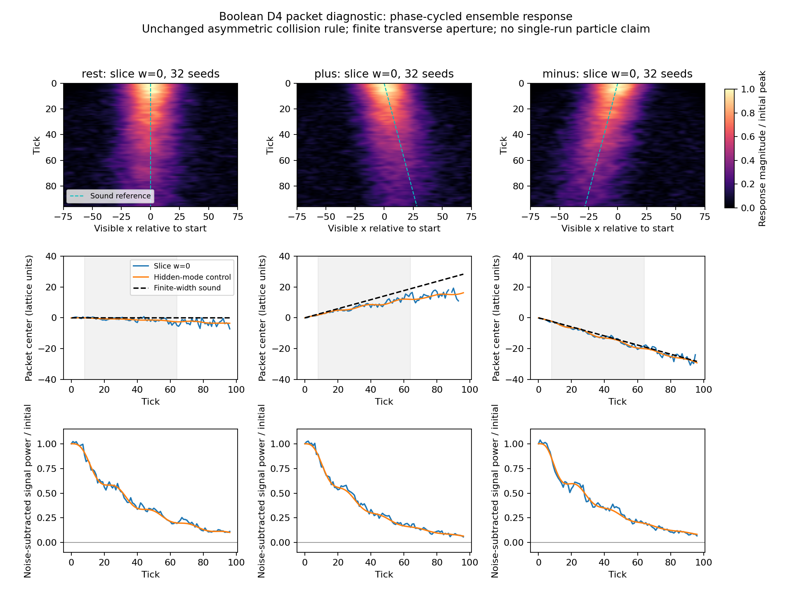

# Bit-Test 6: Lokale Paketantwort und exakte Symmetrieprüfung

Stand: 9. November 2026. Ausgangspunkt: Commit `e2b1e02` / [Bit-Test 5](RESULTS_Bit5_HiddenModes_de.md).

## Ergebnis und Einordnung

**NUMERISCH / positiv:** Die bisher nur über die verborgene Fourierrichtung aufgelöste
Wellenantwort lässt sich auch auf der einzelnen FCC-Schicht **w=0** beobachten.
Eine phasenkontrollierte Ensemblepräparation liefert dort eine lokalisierte, zeitlich
schwingende Antwort. Ein verborgener Fourierfilter wird für diesen Detektorkanal
nicht verwendet. Die Schwingung des nominellen Ruhepakets liegt ungefähr bei
0,143 pro Tick und damit in der Größenordnung der zuvor beobachteten Frequenzlücke.

**EXAKT / negativ:** Die unveränderte reparierte Kollisionsregel kommutiert weder
mit räumlicher Inversion noch mit den geprüften Koordinatenspiegelungen.
Die schön symmetrische D4-Geometrie erzwingt keine entsprechende Kollisionsdynamik.

**NUMERISCH / negativ für die einfache Referenz im Testumfang:** Das nominelle
Ruhepaket driftet. Gegenläufige Pakete bewegen sich nicht spiegelbildlich. Die
Parameter-freie Referenz `omega²=(k²+q²)/2` beschreibt den gemessenen Pakettransport
in diesen Boxen und diesem Zeitfenster nicht quantitativ. Die Asymmetrie ist mit
der exakten Regelverletzung vereinbar; damit ist nicht bewiesen, dass sämtliche
Geschwindigkeitsabweichungen ausschließlich von dieser Verletzung stammen.
Endliche Wellenzahl, Dämpfung, kinetische Beimischungen und Präparation bleiben
weitere Einflüsse.

**Nicht gezeigt:** Ein autonomer Einzelversuchsdetektor, ein in allen drei sichtbaren
Richtungen lokalisiertes stabiles Teilchen, Quantenmasse, Born-Regel oder Lorentzsymmetrie.
Die bisherige Spektraldiagnose aus Bit-Test 5 wird dadurch nicht ungeschehen;
ihre Deutung als bereits bestätigter symmetrischer Paketmechanismus wäre aber zu stark.



## 1. Exakte Symmetrieprüfung

Geprüft werden alle 2325 lokalen Zustände mit null bis drei besetzten Bits auf den
24 Richtungsplätzen. Für jede geometrische Abbildung R wird die von den Wurzeln
induzierte Richtungspermutation benutzt und `C(R(state))` mit `R(C(state))` verglichen.
Die räumliche Transportregel selbst ist unter diesen gemeinsamen Orts-/Richtungs-
abbildungen äquivariant; der hier gefundene Fehler liegt bereits in der lokalen Kollision.

Für die vollständige Inversion `v -> -v` genügt der Zwei-Bit-Eingang `[0,22]`:

- Eingangsrichtungen: `(0,0,1,-1)` und `(1,1,0,0)`;
- zuerst invertieren, dann kollidieren: besetzte Plätze `[7,21]`;
- zuerst kollidieren, dann invertieren: besetzte Plätze `[1,23]`.

Das sind verschiedene endliche Bitmuster. Ein einziges solches Gegenbeispiel
widerlegt die exakte Inversionssymmetrie; eine vollständige Enumeration aller
16.777.216 lokalen Zustände ist dafür nicht erforderlich. Alle acht geprüften
Abbildungen (Inversion, vier einzelne Spiegelungen, drei Achsentausche) besitzen
Gegenbeispiele. Die Rohdaten enthalten jeden ersten Zeugen und alle Trefferzahlen.

Diese Prüfung ist keine Zeitumkehrprüfung. Die Kollision bleibt bijektiv und der
explizite inverse Gesamtalgorithmus funktioniert weiterhin bitgenau.

## 2. Präparation und Messung

Die Box ist `(256,4,4,32)`, enthält 65.536 physische D4-Knoten und pro Knoten genau
24 variable Bits. Zeit bleibt ein separater synchroner Tick. Es gelten periodische
Randbedingungen. Der verborgene Träger hat `q=2*pi/32`, die sichtbaren Träger haben
`k=0,+/-2*pi*4/256`. Die Hüllkurve ist in x gaußförmig mit sigma=16, im Breitentest
sigma=24. In y und z bleibt die Präparation homogen.

Die Vorgabe für die einzelnen Richtungen orientiert sich an der positiven
akustischen Referenz `omega=sqrt((k²+q²)/2)` und dem zugehörigen Dichte-/Impulsverhältnis.
Sie ist **kein nachgewiesener Eigenvektor der tatsächlichen Booleschen Dynamik**.
Die relative Besetzungsabweichung wird durch 16-Bit-Schwellen in konkrete
Anfangsbitmuster übersetzt. Pro unabhängigem Seed werden vier reelle Präparationen
(Cosinus/Sinus, jeweils positives und negatives Vorzeichen) entwickelt. Zufall gibt
es ausschließlich bei der reproduzierbaren Eingabeerzeugung. Nach dem Start sind
sämtliche Updates deterministische Boolesche Operationen und feste Permutationen.

Die komplexe Antwort wird erst außerhalb der Mikrodynamik zusammengesetzt:

`S = (rho_cos_plus - rho_cos_minus + i*(rho_sin_plus - rho_sin_minus))/2`.

Die vorzeichensymmetrische Differenz entfernt gerade Präparationsanteile, garantiert
aber nicht, dass alle ungeraden nichtlinearen Beiträge verschwinden.

Drei getrennte Messkanäle:

1. **Schichtdetektor:** Dichte über acht physische y,z-Knoten je x bei exakt w=0;
2. **Kontrolle:** Fouriergewichtung über die verborgene Richtung bei q;
3. **Kontrolle:** ungewichtetes Mittel über w.

Der erste Kanal benötigt keine Kenntnis anderer w-Schichten. Die Quadraturphase
ist jedoch vom externen Versuchsaufbau vorgegeben und wird zwischen mehreren
reellen Läufen kombiniert. Das ist eine endliche lokale Schichtmessung einer
Ensembleantwort, noch kein selbständiger 3D-Beobachter in einem einzigen Bituniversum.

## 3. Geschwindigkeiten

Die Tabelle verwendet Gitterkoordinateneinheiten pro Tick. Die Schallreferenz
berücksichtigt die tatsächliche endliche Paketbreite: Ein ideales Paket wird mit
der Referenzdispersion entwickelt und mit demselben Ortsmoment ausgewertet. Deshalb
ist die Vergleichsgeschwindigkeit ±0,294 statt der Träger-Gruppengeschwindigkeit
±0,316. Für das breitere Paket beträgt sie ±0,306.

| Präparation | Seeds | Schallreferenz, endliche Breite | FCC-Schicht w=0 | Verborgene Fourierkontrolle |
|---|---:|---:|---:|---:|
| Ruhe, k=0 | 32 | 0,000 | -0,047 ± 0,013 | -0,038 ± 0,003 |
| +k | 32 | 0,294 | 0,204 ± 0,013 | 0,179 ± 0,004 |
| −k | 32 | -0,294 | -0,306 ± 0,015 | -0,317 ± 0,003 |
| +k, breiteres Paket | 16 | 0,306 | 0,209 ± 0,026 | 0,210 ± 0,006 |
| +k, halbe Anregung | 16 | 0,294 | 0,089 ± 0,126 * | 0,187 ± 0,012 |
| +k, kollisionsfrei | 16 | 0,294 | 0,334 ± 0,016 | 0,337 ± 0,003 |

Die Unsicherheiten sind Delete-one-Seed-Jackknife-Standardfehler, **keine** vollständigen
Fehlergrenzen für Präparation, Modellwahl oder Kontinuumsnäherung. Gemeinsam verwendete
Seeds in den Gegenläufen werden für die Asymmetrie gepaart ausgewertet.

* Der lokale Halbamplitudenlauf besteht das Signal-Screening nur an 28 von 57
vorgesehenen Fitzeitpunkten und ist entsprechend unpräzise. Er bestätigt keine
lokale Amplitudenunabhängigkeit. Die besser aufgelöste verborgene Kontrolle ist
bei halber Anregung mit der Vollamplitudenmessung verträglich; die Abweichung von
der Schallreferenz verschwindet dort nicht. Auch das breitere Paket stellt die
Referenzgeschwindigkeit nicht wieder her.

Die Summe der beiden Schichtgeschwindigkeiten, die für perfekte Spiegelung null
sein müsste, beträgt **-0,102 ± 0,017**.
Das ist ein aufgelöster numerischer Asymmetriebefund innerhalb des beschriebenen
Versuchs. Die mikroskopische Symmetrieverletzung ist zusätzlich unabhängig davon
exakt nachgewiesen.

## 4. Sichtbarkeit, Dämpfung und Kontrollen

Für das Ruhepaket ergibt die Phase in einer festen endlichen sichtbaren Apertur
ungefähr 0,1425 ± 0,0005 pro Tick. Dieser Phasenfit erstreckt sich nur über das
vorgegebene kurze Zeitfenster und bestimmt keine exakte Eigenfrequenz. Die Referenz
mit derselben Apertur und endlicher Paketbreite liefert etwa 0,1403. Die
Fourierkontrolle des verborgenen Modus liefert etwa 0,1431. Die Größenordnung der
lokalen Schwingung passt somit zur früheren Spektraldiagnose, nicht jede Nachkommastelle.

| Fall | Schichtleistung bei t=64 / Anfang | Breite bei t=0 | Breite bei t=64 |
|---|---:|---:|---:|
| Ruhe, k=0 | 0,193 | 11,49 | 12,19 |
| +k | 0,155 | 11,56 | 15,08 |
| −k | 0,190 | 11,51 | 12,39 |
| +k, kollisionsfrei | 0,435 | 11,54 | 37,27 |

„Leistung“ bedeutet hier das Quadrat der kohärenten Ensembleantwort, nach Abzug
der geschätzten Rauschleistung. Sie ist **keine mikroskopische Energie**. Ihr Abfall
widerspricht deshalb nicht der exakten Teilchenzahl- und Impulserhaltung. Die Breite
ist ein aus dem kreisförmigen Ortsmoment gewonnenes Intensitätsmaß, kein Teilchenradius.
Das Paket bleibt messbar, ist aber deutlich gedämpft und kein langlebiges stabiles Objekt.

Die kollisionsfreie Kontrolle wird zusätzlich gegen die **exakte Erwartung der
quantisierten Eingabe unter freier Translation** geprüft. Das Verhältnis aus
quadratischem Messfehler und geschätzter Stichprobenrauschleistung beträgt für
Schicht / verborgenen Modus / w-Mittel 0,983 / 0,974 / 0,938: vereinbar mit dem
bekannten freien Transport. Dies ist wegen korrelierter Beobachtungen kein formaler
Chi-Quadrat-Test. Die freie Kontrolle verbreitert sich zudem wesentlich stärker.
Ihre Schwerpunktgeschwindigkeit allein wäre kein Massenbeleg.

Im ungewichteten w-Mittel besteht in keinem Fall die vorgegebene Signalprüfung.
Das ist mit dem Wegmitteln einer nichtkonstanten verborgenen Mode vereinbar,
aber kein allgemeiner Beweis ihrer vollständigen Unsichtbarkeit.

## 5. Auswertung und Prüfungen

Jede unabhängige Antwort wird mit einer festen sichtbaren Gaußapertur sigma=3
geglättet, ohne andere w-Schichten hinzuzunehmen. Für komplexe Seedantworten S_j wird

`I = |mean(S_j)|² - sum(|S_j-mean(S_j)|²)/(n*(n-1))`

verwendet. Negative Schätzwerte werden beibehalten statt als positive Rauschmasse
in einen Schwerpunkt einzugehen. Das kreisförmige erste Ortsmoment liefert Position
und Breite auf der periodischen Box. Geschwindigkeiten werden im vorher gewählten
Fenster t=8..64 geschätzt. Verlangt sind mindestens 24 gültige Zeitpunkte, positive
Gesamtintensität, Signal-/Rauschleistungsverhältnis >3 und kreisförmige Konzentration
>0,2 (zusätzlich eine obere Plausibilitätsgrenze 1,05). Alle drei Hauptfälle bestehen
an sämtlichen 57 Fitzeitpunkten. Späte, verrauschte Werte werden nicht als präzise
Geschwindigkeiten ausgegeben.

Insgesamt: **144 unabhängige Seedfälle, 576 reelle Trajektorien, 55.296 Vorwärtsticks**.
Teilchenzahl und alle vier Gitterimpulskomponenten bleiben in jedem beobachteten
Schritt jeder Trajektorie exakt erhalten; auch die acht Paddingbits bleiben null.

Die schnelle Validierung bestätigt außerdem:

- 128 Vorwärtsticks vollständig identisch mit der Booleschen Referenz;
- acht bitgenaue vollständige Rückläufe;
- korrekte Orts-/Geschwindigkeitsmessung an synthetischen verschobenen Paketen;
- identische gespeicherte Antworten nach simuliertem Abbruch und Wiederaufnahme;
- bereits abgeschlossene Seeds werden übersprungen und nicht neu geschrieben.

## 6. Reproduktion und Ressourcen

```bash
OPENBLAS_NUM_THREADS=1 OMP_NUM_THREADS=1 python src/phase_bit_s4_open25.py symmetry
OPENBLAS_NUM_THREADS=1 OMP_NUM_THREADS=1 python src/phase_bit_s4_open25.py selftest
python src/phase_bit_s4_open25_campaign.py
```

Die Kampagne startet ausschließlich serielle Arbeiter mit jeweils ca. 35 Sekunden
Zielzeit und 60 Sekunden äußerem Timeout. Nach jeder der vier reellen Präparationen
je Seed wird atomar gespeichert. Ein Abbruch kostet höchstens eine kurze Präparation;
der gleiche Befehl setzt fort. Die dynamischen Speichergrößen sind fest begrenzt,
es wird keine 4D-Zeitgeschichte behalten. Neu gestartete Arbeiter haben 1 GiB
Adressraumgrenze und einen zusätzlichen gemessenen RSS-Wächter bei 700 MiB.
Die Produktionsarbeiter lagen tatsächlich bei etwa **202–204 MiB RSS**. Der
zusätzliche Selbsttest benötigte rund 213 MiB. Die automatisierte Hauptkampagne
dauerte nach den bereits abgeschlossenen Pilot-Seeds 429 Sekunden.

Ein einzelner begrenzter Lauf ist ebenfalls möglich:

```bash
OPENBLAS_NUM_THREADS=1 OMP_NUM_THREADS=1 python src/phase_bit_s4_open25.py run --case plus --samples 32 --seconds 35
```

Diesen Befehl bis zum Erreichen der Seedzahl wiederholen. Zwischenstände liegen
unter `data/bit6_checkpoints/` und werden nicht mit Git versioniert. Die aggregierten
Resultate, Prüfberichte und Abbildung werden dagegen versioniert. Die Zusammenfassung
und Abbildung lassen sich ohne erneute Evolution erzeugen:

```bash
OPENBLAS_NUM_THREADS=1 OMP_NUM_THREADS=1 python src/phase_bit_s4_open25.py summarize
python src/phase_bit_s4_open25_figs.py
```

Dateien:

- [`phase_bit_s4_open25.py`](../src/phase_bit_s4_open25.py): Symmetrie, Präparation, Simulation, Auswertung und Selbsttest;
- [`phase_bit_s4_open25_campaign.py`](../src/phase_bit_s4_open25_campaign.py): begrenzte serielle Kampagne;
- [`phase_bit_s4_open25_figs.py`](../src/phase_bit_s4_open25_figs.py): Abbildung;
- [`phase_bit_s4_open25.json`](../data/phase_bit_s4_open25.json): Zahlen, Unsicherheiten, Versuchs- und Auswertungsregeln;
- [`phase_bit_s4_open25.npz`](../data/phase_bit_s4_open25.npz): aggregierte Felder, Intensitäten, Zentren, Breiten, SNR und Referenzen;
- [`phase_bit_s4_open25_symmetry.json`](../data/phase_bit_s4_open25_symmetry.json): exakte Symmetriezeugen;
- [`phase_bit_s4_open25_validation.json`](../data/phase_bit_s4_open25_validation.json): Implementierungs- und Wiederaufnahmetests.

Die versionierten NPZ-Felder reichen zur Darstellung, nicht zur erneuten Jackknife-
Berechnung aus einzelnen Seeds. Dafür werden die lokalen Seed-Zwischenstände benötigt
oder die deterministisch reproduzierbare Kampagne erneut ausgeführt.

## 7. Nächster Forschungsschritt

**Zuerst die Kollisionssymmetrie als exakte Entwurfsbedingung behandeln.** Eine neue
Regel muss Bijektivität, Teilchenzahl und vier Impulskomponenten erhalten und unter
sichtbaren Spiegelungen sowie vollständiger räumlicher Inversion äquivariant sein.
Die Dimension der additiven linearen Erhaltungsgrößen ist erneut zu prüfen, damit
nicht wieder unerwünschte konservierte Größen eingeführt werden.

Die Bedingung muss für den gesamten Aktualisierungsschritt gelten: Einfach alle
symmetrieverwandten Gatter hintereinander anzuwenden garantiert wegen ihrer
Nichtkommutativität noch keine Symmetrie. Ein zusätzliches endliches Taktregister
wäre eine explizite Modellerweiterung und müsste in Symmetrieprüfung und Rücklauf
vollständig einbezogen werden. Eine zufällige Mittelung wird nicht als Lösung einer
deterministischen mikroskopischen Regel ausgegeben.

Erst danach denselben begrenzten Pakettest unverändert wiederholen. Weitere
Boxgrößen oder eine verfeinerte Massendeutung sind vorher weniger aussagekräftig.